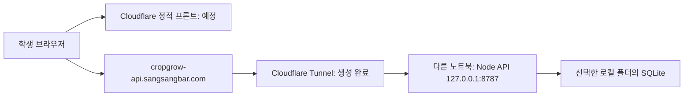

# GrowGame 프로젝트 인수인계

## 2026-11-11 물방울 VFX·전체 최적화 운영 배포 완료

사용자 승인 후 기능 커밋 `ce3bb8a7d2b163955cac23e0252719bfe7fda418`을 GitHub `main`에 push했다. GitHub Actions 실행 `43038266364` 성공, Cloudflare Pages 배포 `7ce49b75-c8da-41ca-ad8c-3b30111173f3` 성공. `https://cropgrow.sangsangbar.com`에 WebAssembly와 JS 대체 빌드가 함께 배포되었다.

실제 도메인의 HTML·Wasm·MJS·코어 폰트·배경 HTTP 200, MIME, 장기 캐시를 확인했다. 배경과 코어 폰트의 SHA-256이 로컬 원본 배포 에셋과 일치한다. 실제 로그인 화면 스크린샷에서 학교 배경·글꼴·입장 화면과 운영 모드(로컬 테스트 표시 없음)를 확인했다.

배포 도메인을 Chrome 390×844·8Mbps·40ms에서 각각 3회 확인한 중앙값은 첫 화면 **4.649초**, 배경 전송 완료 **0.267초**, 재접속 첫 화면 **0.330초**다. Cloudflare Brotli가 적용된 원격 서버 결과이므로 아래 무압축 로컬 전후 수치와 직접 비교하지 않는다. 후속 한자 폰트까지 다운로드가 완료된 뒤 재접속할 때 앱·엔진·이미지·폰트의 추가 전송량이 0바이트인 것도 확인했다. 실제 학교 Wi-Fi와 다수 학생 동시 접속 속도는 검증하지 않았다.

4180/4181 검증용 정적 서버는 종료했다. 검증용 `R:` 별칭도 정리한다. 공식 API·Tunnel은 계속 종료 상태다. 실제 학생 로그인/플레이는 사용자가 `GrowGame 시작.cmd`로 서버를 시작해야 한다. 학생 DB·토큰·로컬 서버 노트북 설정 설명서는 업로드하지 않았다. 후속 문서/측정 스크립트 커밋은 `[skip ci]`로 불필요한 동일 앱 재배포를 생략한다.

## 2026-11-11 전체 로딩 최적화 완료·Git 업로드 승인

**최신 사용자 지시: “깃까지 부탁해.”** 앞선 Git 보류를 해제했다. 물방울·영양분 VFX와 아래 최적화를 함께 commit·push하고 연결된 Cloudflare Pages 배포를 확인한다. 운영 API·Tunnel을 켜라는 지시는 없으므로 종료 상태와 공식 DB를 유지한다.

- WebAssembly/Skwasm 빌드와 기존 JS/CanvasKit 대체 빌드를 함께 생성한다. 별도 격리 헤더 없이 단일 스레드로 실행한다. 두 앱 형식·엔진·기본 아이콘/Roboto 폰트까지 내용 해시 주소로 캐시한다.
- 학교 배경을 HTML에서 먼저 표시한다. 해상도는 유지하며 507,794 → 30,908바이트로 줄였다. 작물·마스코트 원본 PNG는 변경하지 않는다.
- Noto Sans KR의 원본 23,174자·가변 굵기 100~900은 두 파일에 보존한다. 한글 11,172자를 포함한 초기 폰트는 3,908,652 → 1,634,504바이트이며, 한자 등 나머지 8,566자(2,315,640바이트)는 눈에 보이는 에셋을 준비한 뒤 로드한다. 그 전에 필요한 문자는 Flutter 기본 폰트 대체를 사용할 수 있다.
- 현재 작물은 필요한 두 성장 단계부터 표시하고 나머지 단계·수확 이미지는 후속 준비한다. 마스코트·도감 이미지는 로그인 화면부터 준비한다. 도감 11장은 전용 256px 이미지로 591,860 → 224,528바이트, 정원도 별도 256px 이미지를 사용한다. 성장 44장·밑동 위치는 유지한다.

로컬 Chrome 390×844, 8Mbps·지연 40ms, 첫 접속·재접속 각각 3회 중앙값(로컬 정적 서버 무압축):

| 항목 | 변경 전 | 변경 후 |
|---|---:|---:|
| Flutter 첫 화면 | 13.376초 | 8.408초 |
| 현재 작물 준비 | 14.574초 | 8.676초 |
| 학교 배경 전송 완료 | 14.792초 | 0.247초 |
| 재접속 첫 화면 | 1.000초 | 0.327초 |

첫 화면 약 37%, 현재 작물 약 40%, 재접속 약 67% 단축이다. 재접속의 앱·엔진·폰트·이미지는 전송량 0바이트이며 도감 열기 때 추가 썸네일 요청도 0개다. 전체 후속 폰트까지 포함한 전송량은 약 14.12 → 11.25MB다. 운영 Cloudflare의 기존 Brotli·장기 캐시가 정상인 것도 읽기 전용으로 확인했다. 이 로컬 수치는 실제 학교망 속도 보장이 아니다.

검증: `flutter analyze`, 기본 `flutter test` 12개(로컬 전용 1개 기본 제외), 로컬 전용 테스트, 백엔드 테스트와 해시 URL 갱신 테스트 통과. 최종 WebAssembly와 JS 대체 모드 모두 모바일 390×844·작은 모바일 320×568·PC 1920×1080에서 효과·퀴즈/특별 미션·수확·공식 API 미사용을 통과했다. `LOCAL_TEST_MODE` 없는 운영 빌드·GitHub 검사·운영 배포도 성공했다. 측정 스크립트는 `tests/loading.browser.cjs`, 효과/퀴즈/특별 미션/수확 검증은 `tests/flutter.local-vfx.browser.test.cjs`다. 스크린샷·측정 JSON은 OS 임시 폴더에만 둔다.

## 2026-11-11 물방울·영양분 VFX 실제 화면 연결

처음에는 실제 화면에만 적용하고 Git을 보류했으며, 이후 위 최신 지시로 업로드가 승인되었다.

`lib/crops/reward_effect.dart`에 Flutter 기본 애니메이션·Canvas 기반 효과를 구현했다. 물주기는 기존 마스코트의 웅크리기·포물선 점프·물 튀김·물결·복귀, 퀴즈와 특별 미션은 성장 게이지의 빛이 영양분 입자로 바뀌어 작물 밑동에 흡수되는 연출이다. 원본 그림·PNG·성장 기준점은 유지한다. 별도 패키지나 에셋을 추가하지 않았다.

공식 모드는 기존 서버 성공 응답 후에만 2.8초 연출을 시작한다. 확정된 SQLite 상태는 즉시 반영하고, 화면의 성장률만 도착 시점부터 확정값까지 보간한다. 실제 증가분(100% 상한 적용)을 표시하며, 실패한 요청에는 효과를 재생하지 않는다. 입력·탭 이동은 처리 중에 막는다. 동작 줄이기에서는 긴 연출을 생략한다. 화면 종료로 효과가 취소되어도 확정 보상은 유지한다. 기존 로컬 테스트 전용 저장 정책과 서버 채점은 유지한다.

검증: Flutter 분석·기본 테스트 12개(로컬 모드 전용 1개 제외), 로컬 전용 테스트, 백엔드 테스트 통과. 서버 없이 Chrome의 작은 모바일·기본 모바일·PC에서 효과·퀴즈/특별 미션·수확을 통과했다. SDK는 `C:\tmp\growgame-flutter-sdk`, 검증용 영문 드라이브 별칭은 `R:`이다. 운영 API·Tunnel·공식 DB는 켜거나 수정하지 않는다.

## 2026-11-11 추가 최적화: 수확 이미지·반복 접속 (배포 대기)

사용자 요청으로 전체 게임의 이미지 대기와 재접속 로딩을 최적화했다. 정적 파일은 기존처럼 GitHub → Cloudflare Pages에서 제공하며 공식 기록·채점은 SQLite가 기준이다. 원본 PNG는 변경하지 않았다. `scripts/prepare-images.py`가 만든 내용 해시 WebP 62개로 런타임 이미지를 전환했다. 전체 12,952,060 → 5,135,774바이트, 수확 11개 3,149,794 → 591,860바이트, 캐릭터 1,873,210 → 83,838바이트. 성장 이미지 44개의 1024×1024 RGBA 픽셀과 기준점을 유지하며 수확·캐릭터만 화면용 크기 512/256으로 별도 생성했다.

현재 작물 준비 때 수확 이미지도 동일한 ImageProvider/512px 캐시 키로 준비한다. 이후 선택/도감 수확 이미지와 캐릭터를 순차적으로 백그라운드 준비한다. 성장 연출 및 입력 대기는 공통 상수 1.8초 → 0.7초. 서버 성공 응답 전 보상 처리나 공식 localStorage 저장은 추가하지 않았다.

`scripts/finalize-web.cjs`는 빌드된 앱 코드와 CanvasKit 엔진에 내용 해시 URL을 부여한다. 폰트도 해시 파일명으로 변경했다. HTML·manifest는 재검증하고 해시 이미지·폰트·코드·엔진만 1년 immutable 캐시한다. 원래 Flutter 로컬 개발의 엔진 선택은 유지한다. Cloudflare build-web.sh와 GitHub Actions에서 마무리 스크립트를 실행하며 직접 빌드할 때도 flutter build web 후 node scripts/finalize-web.cjs를 실행한다. 생성기(Pillow)는 로컬 에셋 갱신용이고 배포 시 설치할 필요가 없다.

검증: flutter analyze, flutter test 8개 통과(전용 로컬 테스트 기본 제외), 백엔드 테스트, 내용 변경별 코드/엔진 주소 갱신 Node 테스트 통과. Chrome 임시 DB의 로그인·채점·성장·수확·오프라인 복구·3개 화면 크기 통과. 추가 네트워크 검증으로 수확 이미지 다운로드가 클릭 전에 완료되고 수확 팝업을 열 때 추가 다운로드가 없음을 확인했다. 로컬 캐시 허용·8Mbps·40ms 단일 측정에서 첫 접속 17.24초, 재접속 2.70초; 재접속의 앱 코드·엔진·한글 폰트·배경 전송량은 각각 0바이트였다. 운영용 최종 빌드에서도 첫 접속 15.13초·재접속 3.09초와 큰 정적 파일 0바이트 재사용을 추가 확인했다. 실제 학교망 속도를 보장하는 수치가 아니다. 운영 API·Tunnel은 사용자 요청대로 꺼둔 상태이며 테스트는 임시 DB만 사용했다. Git push·Pages 배포 확인은 진행 중이다.


## 2026-11-11 로딩 최적화: 운영 배포 완료

외부 Chrome 확인: 기본 연결의 첫 시도는 큰 파일 다운로드 지연으로 측정 시간 안에 첫 프레임이 확인되지 않았다. 진단을 위해 HTTP/3를 끈 새 브라우저에서는 첫 프레임 약 31.3초, 로딩 안내 제거, 새 폰트 1회 요청을 확인했다. 네트워크 조건이 달라 두 시도의 직접 비교나 원인 확정은 하지 않는다. 외부 실제 속도 개선률을 보장하지 않으며 약 26%는 위 로컬 제한 조건의 결과다. 운영 백엔드를 꺼둔 상태의 API health 530/CORS 실패는 예상된 연결 실패다.

웹 폰트를 전체 TTF 10,414,588바이트에서 WOFF2 3,908,652바이트로 압축했다. 문자 매핑 23,174개, 글리프 24,964개와 가변 굵기 100~900을 유지했으며 원본 TTF와 OFL은 보존했다. pubspec은 WOFF2를 사용하고 HTML에서 폰트를 선로딩한다. Flutter bootstrap을 HTML에 포함해 별도 요청을 줄이고 첫 프레임에서 로딩 안내를 제거한다. 작물 PNG·성장 기준·공식 SQLite 저장 정책은 변경하지 않았다.

Chrome 캐시 없음·8Mbps·지연 40ms·압축 없는 로컬 정적 서버의 첫 프레임 측정은 22.1445초에서 16.3309초로 약 26% 단축됐다. 단일 로컬 비교이며 Cloudflare 압축 및 실제 학교망의 성능을 뜻하지 않는다. Chrome에서 압축 폰트 요청은 한 번이며 로딩 안내 제거와 한글 화면을 확인했다. Flutter 테스트 8개 통과(로컬 모드 전용 1개 기본 실행 시 제외), 백엔드 테스트 통과. 기존 성장 테스트는 이미지 준비 완료 후 UI 반영 한 프레임을 기다리도록 보정했다. Chrome 통합 테스트는 임시 DB로 PIN 등록·채점·성장·수확·도감·오프라인 복구·3가지 화면 크기를 통과했다.

이 노트북에는 Flutter SDK가 없어 C:\Temp\growgame-flutter-sdk에 기존 CI와 같은 3.47.9를 준비했다. 한글 경로 분석 서버 오류를 피하기 위해 비어 있던 R:를 프로젝트 영문 별칭으로 사용했다. 검증 임시 DB는 삭제했고 C:\scr\grow 공식 DB와 운영 API·Tunnel은 종료 상태를 유지한다. 운영 빌드는 LOCAL_TEST_MODE 없이 실제 API 도메인으로 수행한다. 검증 후 R: 별칭과 테스트용 정적 서버를 정리했다. GitHub main 커밋 6b164acc34023952025cd880eba67a08ab813a0b push 완료. GitHub Actions Flutter Web 성공, Cloudflare Pages 배포 d10456fa-1c56-4f49-b09c-62f8dd79bf8e 성공. 사용자 도메인의 HTML·압축 폰트 HTTP 200과 font/woff2 MIME, 폰트 SHA-256 일치, 운영 FontManifest의 WOFF2 참조를 확인했다. 공식 API·Tunnel은 사용자 요청대로 종료 상태이며 프론트 배포 완료가 백엔드 가동을 뜻하지 않는다.


## 2026-11-11 DB 저장 폴더 변경 완료

사용자 요청으로 DB 본체와 WAL·SHM 세 파일을 서버 종료 상태에서 C:\scr\grow로 이동했다. 기존 대상 파일 덮어쓰기 없이 이동 전후 SHA-256 일치 및 SQLite integrity_check 정상 결과를 확인했다. 로컬 config.json의 dataDirectory도 C:\scr\grow로 변경했다. 공식 DB는 C:\scr\grow\growgame.sqlite이며 통합 실행 파일은 이 설정을 그대로 사용한다. 서버는 종료 상태를 유지한다.


## 2026-11-11 사용자 요청으로 서버 종료

사용자 요청으로 현재 노트북의 GrowGame API와 Cloudflare Tunnel을 종료했다. 두 프로세스 종료와 로컬 8787 포트 대기 없음 확인. 이전 healthy·외부 health 200은 실행 중에 확인한 이력이며 현재 가동 상태가 아니다. DB `C:\scr\growgame.sqlite`, 로컬 설정, 암호화된 Tunnel 토큰과 바탕화면 바로가기는 보존했다.

직접 시작: 현재 프로젝트 폴더의 **GrowGame 시작.cmd**를 더블클릭하면 API와 Tunnel 실행 창이 함께 열린다. 두 창을 유지한다. 이 통합 실행 파일은 같은 폴더의 기존 바로가기 두 개를 사용하므로 세 파일을 함께 보관한다. 개별 실행도 가능하다. 프로젝트 폴더의 바로가기 두 개는 이 PC 전용이며 Git 로컬 제외 목록으로 업로드를 방지했다. 두 창을 유지한다. 종료: Tunnel 창에서 Ctrl+C, API 창에서 Ctrl+C를 누른 뒤 창을 닫는다. 재부팅 후 자동 실행되지 않는다.


## 현재 노트북 서버 설정 완료 (2026-11-11)

사용자가 현재 이 노트북을 백엔드 서버로 지정했다. 이전의 다른 노트북 사용 방침을 대체한다. 학생 DB는 사용자 지정 `C:\scr\growgame.sqlite`에 저장하며 기존 폴더와 파일은 보존했다. Node.js 24.20.0, cloudflared 2026.10.1을 확인했다. DB 경로 설정은 `%LOCALAPPDATA%\growgame-server\config.json`에, Tunnel 토큰은 같은 설정 폴더의 `tunnel-token.clixml`에 Windows 사용자 DPAPI로 암호화해 보관한다.

현재 API와 HTTP/2 Tunnel을 실행했다. 로컬 및 외부 `/api/health` HTTP 200, 프론트 Origin 허용 헤더, Tunnel `healthy`와 연결 4개를 확인했다. `node --test backend/backend.test.cjs` 통과. 실제 미션 콘텐츠 등록, 학생 등록·행동, 학교 Wi-Fi 다수 사용자 검증은 남아 있다. 실제 콘텐츠나 학생 기록을 자동 입력하지 않았다.

API와 Tunnel은 현재 도구 관리 세션에서 실행 중이다. 숨김 백그라운드 시작은 자동 승인 검토에서 거부되어 적용하지 않았다. Windows 서비스·자동 시작·전원 설정은 변경하지 않았다. 재부팅 또는 실행 세션 종료 후 바탕화면 **GrowGame API**, **GrowGame Tunnel**을 각각 실행하고 두 창을 유지한다. 이미 실행 중이면 중복 실행하지 않는다. 종료는 각 창의 Ctrl+C다.

아래 다른 노트북·Tunnel inactive 관련 과거 기록은 위 설정 이전의 이력이다. Understand 분석은 제외 목록 확인 단계에서 대기 중이며 그래프는 아직 생성하지 않았다.


최종 정리 기준: **2026-11-11, Asia/Seoul**. 다음 AI와 유지보수 담당자는 이 문서를 먼저 읽고 실제 파일·Cloudflare 상태를 다시 확인한다. 이 문서는 코드나 DB 자체를 대체하지 않는다.

서버 노트북 설정 설명서는 사용자의 최신 요청으로 로컬 프로젝트에만 보관한다. Git 추적에서 제외했으므로 다시 업로드하지 않는다.

## 2026-11-11 에셋 배경 수정·GitHub·프론트 배포

사용자가 GitHub 업로드와 Cloudflare 연결을 다시 요청해 이전 Git 보류 지시를 해제했다. GitHub `main`에 최초 소스와 수정된 에셋을 push했다. 복숭아 2~4단계, 수박 2~4단계, 고추 4단계 총 7장의 흰 배경을 제거했다. 이미지 생성 도구 결과는 그림과 크기가 달라 채택하지 않았고, 사용자가 원본 픽셀 기반 코드 처리를 명시적으로 승인했다. 중성색 잔여물의 알파만 수정했으며 보이는 픽셀 RGB 유지, 1024×1024 규격, 불투명 흰 배경 0개를 원본 백업과 비교했다. 무·배추 흰색은 보존했다. 원본 백업은 개발 PC의 `%USERPROFILE%\.codex\asset-backups\growgame-20261111\crops`에 있으며 Git에는 넣지 않았다.

`flutter analyze`, `flutter test` 8개(로컬 모드 전용 1개는 기본 실행 시 건너뜀), 백엔드 통합 테스트와 최종 에셋 성장 테스트 3개가 통과했다. Pages Git 연동, 사용자 도메인 활성화, 프론트 HTML·PNG HTTP 200을 확인했다. 최신 에셋 커밋 `1030812`의 배포 `75fc7560-7623-4e2f-b0b5-9d5c05ef2adf`는 성공했다. 사용자 도메인에서 받은 수정 PNG 7장 모두 로컬 최종 파일과 SHA-256이 일치했다. 백엔드 Tunnel은 서버 노트북 커넥터 미실행 상태이므로 학생 서버 접속 성공으로 해석하면 안 된다.

문서만 변경하는 커밋은 `[skip ci]` 접두어로 불필요한 프론트 재빌드를 생략한다. 배포된 코드·에셋과 저장소의 코드·에셋은 같다.

## 2026-11-11 추가 결정: 서버 없는 로컬 테스트

사용자는 로컬 화면 테스트에 백엔드를 켜지 않기로 결정했다. `flutter run -d chrome --web-port=4180 --dart-define=LOCAL_TEST_MODE=true`로 실행한다. `lib/local_test_data.dart`의 참여자 1개(1학년 1반 1번)를 자동으로 열며 브라우저의 `growgame.local-test.v1`에 저장한다. 샘플 퀴즈·특별 미션도 로컬에서 확인한다. PIN과 API 연결은 이 모드에서 사용하지 않는다. 공식 모드의 학생 데이터·채점 정책은 바꾸지 않았다.

로컬 테스트 미션 저장 키는 `growgame.local-test.missions.v1`이다. 실제 서버 데이터나 과거 체험판 기록을 덮어쓰지 않는다. 화면에 작은 “로컬 테스트” 표시가 있으며, 배포 빌드는 이 플래그 없이 수행해야 한다. 이 모드의 전용 검증은 `flutter test --dart-define=LOCAL_TEST_MODE=true test/local_mode_test.dart`다.

## 현재 사용자 결정과 작업 상태

| 항목 | 결정 / 상태 |
|---|---|
| 프론트 | Flutter Web. 모바일 중심, 태블릿·PC에서도 같은 세로 비율을 최대 확대 |
| 프론트 예정 주소 | `https://cropgrow.sangsangbar.com` |
| API 주소 | `https://cropgrow-api.sangsangbar.com` |
| 백엔드 실행 위치 | **현재 이 Windows 노트북**, DB `C:\scr` |
| 서버 방식 | Node.js 24 LTS + SQLite, 노트북에서 수동 실행·종료 |
| DB 폴더 | `C:\scr` 설정 완료, 공식 DB `growgame.sqlite` |
| 이미지·폰트 | 프론트에서 배포. 노트북 백엔드가 이미지 파일을 보내지 않음 |
| 학생 데이터 | 성장률·수확·도감은 서버 조회 및 서버 저장 |
| 로그인 | 최초 학년·반·번호에 숫자 4자리 PIN 등록, 이후 기존 PIN 확인 |
| 퀴즈 | 항상 4지선다. 문제·보기·정답은 백엔드 관리, 채점도 서버에서 수행 |
| 관리자 | 공개 관리자 쓰기 API나 관리자 비밀번호 화면 없음. 노트북 관리 명령으로 등록 |
| 오프라인 | 작은 연결 안내. 이미 받아 둔 화면은 유지하되 성공 응답 없이 보상을 늘리지 않음 |
| 동시 사용자 목표 | 100~500명. 실제 학교 노트북·학교망의 현장 부하 검증은 아직 안 함 |
| GitHub 저장소 | `https://github.com/ryowoo2726-hue/crops-grow` |
| **Git 지시** | 2026-11-11 최신 요청으로 에셋 수정 및 GitHub 업로드·Cloudflare 연결 허용. 이전 보류 지시 해제 |
| Cloudflare | 계정 연결 정상. `sangsangbar.com` zone 활성 상태 확인 |
| API Tunnel / DNS | 연결 설정 완료. 사용자 요청으로 API·Tunnel 종료, 수동 재실행 대기 |
| 프론트 배포 | Pages `cropgrow`, GitHub `main` 자동 배포 연결 및 프론트 CNAME 생성 완료 |

이전 HTML/CSS/JS 데모와 전용 아이콘·미리보기·테스트 38개는 정리했다. 디자인 원본, Figma 작업 자료, 작물 PNG, 기획서는 보존했다.

## 전체 흐름



학교 공유기의 포트포워딩으로 노트북을 공개하는 구조가 아니다. 노트북의 `cloudflared`가 Cloudflare로 나가는 연결을 만들고 요청을 로컬 API에 전달한다. 학교망에서 필요한 outbound 통신이 허용되어야 한다. 차단되면 네트워크 담당자에게 허용을 요청한다.

## 주요 파일 지도

| 경로 | 역할 |
|---|---|
| `lib/main.dart` | 반응형 앱 프레임, PIN 입장, 내 밭·정원·도감, 팝업, API 호출과 상태 반영 |
| `lib/game.dart` | 작물 11종 목록, 기존 기록 검증, 서울 날짜, 데모 성장 규칙 |
| `lib/backend/api.dart` | API 기본 주소, 메모리 세션 토큰, JSON 응답/오류 처리, 요청 12초 제한 |
| `lib/backend/transport_web.dart` | 브라우저 fetch. 응답은 no-store |
| `lib/backend/transport_stub.dart` | 네이티브 위젯 테스트용 네트워크 대체 구현 |
| `lib/crops/crop_growth.dart` | 현재 에셋을 사용하는 공통 성장 애니메이션, 4장 미리 로드, 밑동 고정 |
| `lib/missions/quiz/content.dart` | 퀴즈 데이터 형식·보기 정확히 4개 검증. 실제 문제 저장 파일 아님 |
| `lib/missions/quiz/popup.dart` | 선택·서버 정답 확인·오답 재시도·다음 문제·완료 UI |
| `lib/missions/special/popup.dart` | 특별 미션 내용 및 수행 확인 UI |
| `lib/missions.dart` / `lib/storage*.dart` | 이전 로컬 체험 데이터 호환과 위젯 테스트용. 공식 서버 저장과 혼동 금지 |
| `assets/crops/` | 11종 × 성장 4단계 + 수확물 = 55장 |
| `assets/environment/` | 학교 배경, 벼용 논과 나머지 작물용 마른 밭 |
| `assets/asset-manifest.json` | 원본 이미지 메타데이터. 성장 높이 값은 참고치이며 런타임 강제 리사이즈 기준이 아님 |
| `backend/server.cjs` | HTTP API 라우팅·CORS·요청 검증·세션 인증 |
| `backend/store.cjs` | SQLite 쿼리, PIN 해시·잠금, 성장·수확·채점·중복 방지·관리 import |
| `backend/schema.sql` | SQLite 스키마 v1, WAL·FK·캐시 설정 |
| `backend/config.cjs` | 명시한 경로 / 환경변수 / 노트북에 기억한 DB 경로 읽기 |
| `backend/start.ps1` | 서버 노트북의 최초 DB 폴더 선택창과 API 실행 |
| `backend/start-tunnel.ps1` | 다른 노트북의 Tunnel 수동 실행. 토큰은 DPAPI로 해당 사용자 로컬에 저장 |
| `backend/tunnel-info.json` | 실제 Tunnel/zone ID와 origin. 비밀 토큰은 포함하지 않음 |
| `backend/manage.cjs` | 초기화, 주간 퀴즈·특별 미션 import, 안전한 백업, 교사용 PIN 초기화 |
| `server.cjs` | **프론트 로컬 확인용** 4174 포트 정적 서버. 학생 API 서버가 아님 |
| `web/_headers` | 재배포 시 같은 이름의 수정 PNG를 재검증하도록 하는 캐시 헤더 |
| `.github/workflows/frontend.yml` | GitHub push/PR 검사·빌드 아티팩트 |
| `scripts/build-web.sh` | Cloudflare Git 빌드용. Flutter 준비 후 `build/web` 생성 |

## 화면 및 게임 규칙

- 로그인 선택칸은 같은 크기이며 `24번`, `10반`, `3학년`처럼 한 줄로 표시한다.
- 휴대폰은 너비 390 논리 픽셀, 최소 높이 694를 기준으로 화면 높이를 활용한다. 더 큰 화면은 390×844를 균일 확대하고 가운데 배치한다.
- `FittedBox`를 `SizedBox.expand` 안에 둔다. 느슨한 `Center` 안에만 두면 PC에서 원래 크기보다 커지지 않았던 문제가 있었다.
- 내부 Navigator와 MediaQuery도 논리 화면 크기로 맞춰 팝업과 터치 좌표가 함께 확대되게 한다.
- 게이지 아래에는 작은 미션·메시지 버튼만 둔다. 미션 선택 팝업에는 퀴즈·특별 미션 두 종류만 있다. 메시지는 빈 안내 팝업이다.
- 우측 상단 톱니바퀴는 제거했다. 개인 설정·로그아웃은 상단 학년·반·번호를 누른다.
- 물주기 +50%, 미션 +30%, 성장률 최대 100%. 100% 이후 수확하고 다음 작물을 고른다.
- 실제 서비스에서는 학생이 일일 제한을 바꿀 수 없다. 서버 `DAILY_LIMIT`로 결정한다.
- 현재 기본값은 반복 참여(`false`)다. `true`이면 물주기/미션 각각 하루 1회이며 퀴즈와 특별 미션은 미션 보상 횟수를 공유한다. 이 모드의 최초 하루 최대 성장량은 80%라는 점을 운영 규칙 결정 때 고려한다.

## 2026-11-10 에셋 수정과 성장 렌더러

사용자가 수정한 최신 PNG를 직접 확인했다. 원본 파일을 재생성하거나 픽셀을 수정하지 않았다. 벼·고구마·콩·무·배추·사과·감·복숭아·수박·고추·망고 모두 같은 렌더러를 사용한다.

- 각 이미지: 1024×1024 PNG. 공통 밑동 기준은 원본의 가로 50%, 세로 82%다.
- 0%, 약 33.3%, 약 66.7%, 100%가 각 성장 단계의 원본 모습에 해당한다.
- 두 이웃 단계의 투명도를 부드럽게 바꾸고, 들어오는 단계는 밑동 기준 94%→100%로 아주 조금 자란다. 나가는 원본의 크기는 유지한다.
- 100%는 네 번째 PNG를 원본 비율 그대로 표시한다. 단계 경계에서 크기가 튀지 않는다.
- 한 번의 성장 연출은 1.8초이며 저장된 성장률로 재입장할 때 0%부터 다시 재생하지 않는다. 동작 줄이기 설정도 존중한다.
- 현재 작물의 4장만 미리 준비한다. 화면에는 최대 2개의 성장 레이어만 그린다. 서버 모드에서는 작물 이미지 준비 전 성장 입력을 잠시 막는다.
- PNG 사이의 전환이며 잎·줄기별 벡터 모핑은 아니다. 다음 에셋 수정에서 밑동 위치 자체가 달라지면 `cropRootAnchor` 또는 개별 보정 정책을 검토해야 한다.
- PNG를 교체한 뒤 프론트를 **다시 빌드하고 페이지를 새로고침**해야 한다. 앱 메모리에 이미 디코딩한 이미지가 들어 있는 동안 파일 교체만으로 즉시 바뀌지는 않는다.

## 데이터의 기준과 메모리 사용

| 저장 위치 | 데이터 |
|---|---|
| Cloudflare 정적 프론트 | Flutter 코드, 작물·배경·캐릭터 이미지, 폰트 |
| 프론트 메모리 | 현재 학생 상태, 세션 토큰, 현재 퀴즈, 정원 현재 페이지 9칸 |
| SQLite | 학생 PIN 해시, 성장 상태, 수확 기록, 정답, 서버 채점 기록, 중복 요청 방지 기록 |
| 서버 노트북 설정 폴더 | DB 저장 위치, 해당 Windows 사용자에게 암호화된 Tunnel 토큰 |

도감 개수와 전체 수확 개수는 수확 테이블에서 집계한다. `/api/me`는 모든 과거 수확을 보내지 않고 작물별 개수만 보낸다. 호환용 `harvests: []` 필드가 비어 있어도 실제 수확이 없는 것이 아니다. UI는 `harvestCount`와 `collectionCounts`를 사용한다.

`assets/fonts/NotoSansKR.ttf` 원본은 약 10MB다. 학교망 최초 접속 성능을 볼 때 폰트 전송·압축·서브셋 가능성도 별도로 검토한다. 현재는 글자 누락을 피하려고 원본을 유지했다.

로그인·행동·메뉴 변경·창 복귀 때 필요한 정보를 조회하고, 활성 화면에서는 약 60초 주기로 작은 개인 상태를 재확인한다. 전체 학생 기록을 브라우저마다 내려받지 않는다. 이미지 캐시는 64MiB, SQLite 페이지 캐시는 약 4MiB로 설정했으며 각각 프로세스 전체 RAM 상한을 뜻하지 않는다. 도감·정원은 작은 크기로 이미지를 디코딩한다.

`GrowGame(demo: true)`는 이전 로컬 흐름을 검증하는 테스트 경로다. 실제 앱의 기본 생성자는 서버 모드다. 공식 데이터를 localStorage에 쓰지 않는다. 이전 체험판 localStorage 원본은 삭제하지 않았지만 새 DB로 자동 수입하지도 않았다.

## 로그인·채점·저장 흐름

1. 학년·반·번호와 4자리 PIN으로 `/api/session`을 호출한다. 미등록 번호이면 생성하고 등록된 번호이면 해시를 확인한다.
2. 서버는 scrypt + 임의 salt로 PIN을 저장한다. PIN 원문은 DB나 프론트 저장소에 보관하지 않는다. 5회 실패 시 해당 번호를 15분 제한한다.
3. 세션 토큰은 프론트 메모리에만 존재한다. 서버 DB에는 SHA-256 토큰 해시를 저장한다. 세션은 8시간이며 새로고침하면 재입장한다.
4. 로그인 응답과 `/api/me` 상태로 밭·수확 수·도감을 그린다. 서로 다른 세션의 늦은 응답으로 학생 상태를 바꾸지 않도록 세션/수정 버전을 확인한다.
5. 퀴즈는 현재 주차의 질문과 보기 네 개만 받는다. 답을 제출하면 서버가 판정하고, 정답일 때만 해설과 정답 여부를 응답한다.
6. 모든 현재 버전 문제를 맞혔는지 서버가 확인해야 퀴즈 보상을 지급한다. 문제를 재등록하면 버전이 올라가 이전 답안·진행 중 요청은 새 버전에 쓸 수 없다.
7. 성장·수확·심기는 `/api/actions` 트랜잭션으로 처리한다. 클라이언트가 성장률이나 수확 개수를 직접 지정하지 않는다.
8. 각 행동에는 요청 번호가 있다. 같은 요청이 재전송돼도 같은 학생의 보상을 두 번 늘리지 않는다. 연결 실패 후 재시도에는 기존 번호를 재사용한다.

초기 번호 등록은 **먼저 등록한 사람 기준**이다. 학교 명단 본인 확인이나 교사 사전 등록은 아직 없다. 4자리 PIN은 장기 계정 인증 시스템과 같지 않다. 행사 전 최초 등록 운영 방식과 일일 보상 횟수를 결정해야 한다. 교사는 서버 노트북의 `reset-pin` 명령으로 분실 PIN을 초기화할 수 있고 기존 세션은 취소된다.

## SQLite 스키마 v1

| 테이블 | 역할 |
|---|---|
| `players` | 학년·반·번호 유일 키, PIN 해시·salt·실패 제한, 현재 작물·성장률·일일 기록·수정 버전 |
| `sessions` | 학생별 토큰 해시와 만료 시각 |
| `harvests` | 개별 수확 이력. 도감과 반 정원의 원본 |
| `quiz_weeks` | 주차와 퀴즈 수정 버전 |
| `quiz_questions` | 보기 4개 고정 컬럼, 정답 인덱스 0~3, 해설 |
| `quiz_answers` | 학생이 맞힌 현재 주차·버전·문제 기록 |
| `special_missions` | 주차별 제목·내용·수정 버전 |
| `action_receipts` | 학생/요청 번호 기준 중복 반영 방지 |

WAL 모드와 FK를 켜고 prepared statement를 사용한다. 세션과 오래된 요청 기록은 시작/로그인 시 적절히 정리한다. 스키마 수정 시 `CREATE TABLE IF NOT EXISTS`만 바꾸면 기존 DB가 바뀌지 않는다. 운영 DB를 백업하고 버전별 마이그레이션을 추가해야 한다.

## API 지도

| 메서드 / 경로 | 용도 |
|---|---|
| `GET /api/health` | 연결 확인. 인증 불필요 |
| `POST /api/session` | `{profile:{grade,classNo,number},pin}`으로 최초 등록 또는 로그인 |
| `POST /api/logout` | 현재 세션 취소 |
| `GET /api/me` | 현재 학생 상태 및 집계 |
| `GET /api/garden?page=0` | 같은 학년·반의 수확을 9칸씩 조회 |
| `GET /api/quizzes/current` | `{week,revision,questions:[{id,question,choices}]}`. 정답 필드는 없음 |
| `POST /api/quizzes/check` | `{week,revision,questionId,answerIndex}`. 0~3 선택 |
| `GET /api/missions/current` | 현재 주의 특별 미션 또는 null |
| `POST /api/actions` | `{kind,requestId,cropId?,missionRevision?}`. kind는 water/harvest/plant/quiz/special |

로그인·health 외 API는 `Authorization: Bearer <세션 토큰>`이 필요하다. 응답은 no-store이며 CORS는 허용된 프론트 origin만 반영한다. CORS 자체를 학생 인증으로 오해하지 않는다. 400은 입력, 401은 재로그인, 409는 이미 처리/진행 조건/수정 버전 충돌, 429는 PIN 재시도 제한이다. 네트워크 실패와 5xx는 작은 연결 안내로 처리한다.

## Cloudflare 실제 리소스 기록

계정과 기존 다른 프로젝트는 조회만 했고 변경하지 않았다. 이 작업에서 만든 리소스는 아래 두 개와 Tunnel ingress 설정이다. **토큰은 이 문서에 없다.**

| 리소스 | 식별자 / 값 |
|---|---|
| Account ID | `1ea0633d16d8c951812c6a18ce932394` |
| `sangsangbar.com` Zone ID | `da77fffb3dc5c6f2b125562bb9b52bf9` |
| Tunnel 이름 | `cropgrow-api` |
| Tunnel ID | `f376c53c-e868-4d64-b83e-2dc8e1098fe5` |
| 관리 방식 | remotely managed / `config_src: cloudflare` |
| Ingress | `cropgrow-api.sangsangbar.com` → `http://127.0.0.1:8787`, 마지막 규칙은 HTTP 404 |
| DNS record ID | `053fba0a65660fed4b7142402de89cb8` |
| API DNS | proxied CNAME → `f376c53c-e868-4d64-b83e-2dc8e1098fe5.cfargotunnel.com` |
| 마지막 확인 상태 | `inactive`: 다른 노트북의 cloudflared를 아직 실행하지 않음 |

현재 API URL은 실제 서비스를 제공하는 healthy 상태가 아니다. DNS 생성 완료와 백엔드 가동 완료를 구분한다. 프론트는 Pages Git integration으로 연결했다. Pages 프로젝트 `cropgrow`, 기본 주소 `cropgrow.pages.dev`, 사용자 주소 `cropgrow.sangsangbar.com`이다. 프론트 CNAME ID는 `282167b9b3efca6770d85c034ce99d0b`, 도메인 연결 ID는 `a13b78f8-89eb-42a2-9a02-fca0a0c3c6f5`다.

Git 빌드 명령은 `bash scripts/build-web.sh`, 출력 폴더는 `build/web`, API 환경값은 실제 API 도메인이다. GitHub `ryowoo2726-hue/crops-grow`의 `main` push가 프로덕션 빌드를 실행한다. Preview 자동 배포와 PR 댓글은 꺼 두었다. `.github` 워크플로는 검사/아티팩트용이며 Cloudflare 토큰을 요구하지 않는다. 배포에 `LOCAL_TEST_MODE=true`를 넣지 않는다.

## 다른 노트북의 실행 순서

1. Node.js 24 LTS와 `cloudflared`를 설치하고 프로젝트를 복사한다.
2. 첫 PowerShell 창에서 `backend/start.ps1` 실행 → DB를 둘 **로컬 폴더**를 선택한다. `start.ps1 -ChooseFolder`로 다시 선택할 수 있지만 기존 데이터를 자동 이동하지 않는다.
3. 다른 PowerShell 창에서 `backend/start-tunnel.ps1` 실행 → 첫 회에 Cloudflare의 해당 Tunnel 토큰을 숨김 입력한다. `Networking → Tunnels → cropgrow-api → Add a replica`에서 확인한다.
4. 토큰은 Windows DPAPI로 해당 노트북·사용자에게 암호화해 `%LOCALAPPDATA%/growgame-server/tunnel-token.clixml`에 저장한다. 다음 실행부터 다시 묻지 않는다. 다른 컴퓨터나 사용자로 복사해 사용하지 않는다. `-ResetToken`으로 다시 입력한다.
5. 노트북의 `/api/health`와 외부 API 도메인의 `/api/health`가 모두 성공하는지 확인한다. Tunnel 상태도 healthy인지 확인한다.

학교망은 Cloudflare로 나가는 7844 TCP/UDP 연결 조건을 확인해야 한다. 필요한 경우 `start-tunnel.ps1 -Protocol http2`로 TCP 방식을 선택한다. TCP까지 차단되어 있으면 네트워크 담당자의 허용이 필요하다. 자동 시작 서비스나 현재 개발 PC의 커넥터는 설치하지 않았다.

DB 경로 설정은 `%LOCALAPPDATA%/growgame-server/config.json`에 기록한다. Node CLI는 `--data-dir 절대경로`, `GROWGAME_DATA_DIR`, 저장된 설정 순으로 읽는다. 실행 중인 SQLite를 Google Drive·OneDrive 등에 두지 않는다.

백업은 `node backend/manage.cjs backup 새백업.sqlite`를 사용한다. 복원은 서버 종료 → 새 빈 폴더에 백업을 `growgame.sqlite`로 복사 → 폴더 재선택 순서다. 실행 중인 `.sqlite`만 복사하거나 다른 시점의 WAL과 섞지 않는다.

## 주간 콘텐츠 수정

`backend/quiz.template.json`, `backend/special.template.json`을 복사해 `backend/content/` 아래에서 수정한다. 이 폴더는 Git 제외 대상이다. 템플릿은 자동으로 학생에게 노출하지 않는다.

```powershell
node backend/manage.cjs import-quiz backend/content/이번주.json
node backend/manage.cjs import-special backend/content/특별미션.json
node backend/manage.cjs reset-pin 학년 반 번호
```

주차는 서울 날짜 기준 월요일이며 퀴즈는 최대 20문제다. 모든 보기는 서로 다른 네 개여야 한다. 정답은 0부터 세는 인덱스다. 내용 변경은 DB만 갱신하며 프론트 재배포가 필요 없다. 팝업 디자인이나 진행 UI를 바꾸면 프론트를 재빌드해야 한다.

## 검증과 알려진 오류 이력

현재 코드 기준 Flutter 테스트 **8개**, 백엔드 통합 테스트, 정적 분석을 통과했다. 수정된 에셋을 포함한 실제 Chrome 통합 흐름도 통과했다. 로컬 테스트가 실제 Cloudflare를 경유한 학교 노트북 연결 성공을 뜻하지는 않는다.

- `flutter analyze`: 정적 분석.
- `flutter test`: 퀴즈 흐름, 저장 규칙, 5가지 화면 크기, 에셋 55장 규격, 성장 경계·복원 애니메이션.
- `node --test backend/backend.test.cjs`: PIN·실패 제한·CORS·서버 채점·중복 보상·반 분리·백업·재시작 복원·PIN 초기화. 총 500회 조회를 동시성 50씩 검증한다. 실제 학생 500명이 학교망에서 동시에 접속한 검증은 아니다.
- `tests/flutter.browser.test.cjs`: 프론트를 `API_BASE_URL=http://127.0.0.1:8787`로 빌드하고 `node server.cjs` 실행 후 사용한다. 테스트가 임시 DB와 8787 API를 직접 시작/종료하므로 해당 포트 개발 서버는 먼저 끈다. PIN 등록 → 채점 → 성장/수확/도감 → 오프라인/복구와 3가지 크기를 확인한다.
- UI 검증 스크린샷은 OS 임시 폴더에 남긴다. 사용자 DB나 Git에 넣지 않는다. 현재 학교 노트북에서 실서비스 연결 검증은 미완료다.

주의할 오류:

1. **Dart Web의 `1 << 32`**를 난수 상한으로 쓰면 웹 컴파일에서 0이 되어 수확 요청이 실패했던 적이 있다. `0x100000000`을 유지한다.
2. Windows 한글/Google Drive 경로에서 Flutter 분석 서버 문자열 오류가 있었다. 사용하지 않는 영문 드라이브 별칭으로 같은 폴더를 참조하면 해결됐다. 다른 작업이 사용하는 별칭을 임의로 해제하지 않는다.
3. 빌드 성공 표시 후 이미지 파일들이 배포 폴더에서 누락되어 404가 난 적이 있다. 원인은 확정하지 않았다. 경로와 파일 존재를 확인한 뒤 `flutter clean` → `flutter pub get` → 재빌드로 복구했다. 원본 PNG를 삭제해 해결하려 하지 않는다.
4. Cloudflare Pages 목록 API에서 `per_page=100`은 오류 `8000024`가 났다. `per_page=10,page=1`로 조회하고 페이지 정보를 확인한다.
5. Cloudflare 플러그인 도구는 처음에는 노출되지 않았지만 현재 MCP 조회·생성이 정상 동작한다. 브라우저 자동화는 URL 확인 실패로 중단됐던 이력이 있다. 지금은 Cloudflare MCP를 우선 사용한다.
6. 브라우저 테스트는 Flutter semantics에서 팝업 제목이 일반 textContent로 보이지 않을 수 있다. 본문/실제 활성 버튼을 확인한다. 비활성 버튼을 미리 누르는 테스트를 만들지 않는다.
7. 로컬 테스트에서 TCP 요청 500개를 한 번에 생성한 경우 연결 거절이 있었다. 현재 검증은 연결 폭주를 줄여 동시성 50으로 수행한다. 학교 노트북의 실사용 성능을 증명한 것으로 보고하지 않는다.
8. 브라우저 검증의 `flutter-view` 대기 시간 초과가 나면 먼저 4174 정적 서버의 실행 여부와 `/` 응답을 확인한다. 이전 턴의 개발 서버가 종료되어 있었던 경우 `node server.cjs`를 다시 실행해 해결했다.

## 다음 작업과 문서 갱신 원칙

1. 최신 사용자 지시를 확인한다. 현재는 에셋 수정·GitHub 업로드·Cloudflare 연결이 허용되었다.
2. 현재 노트북 API·DB·Tunnel 연결 완료. 재부팅 후 바로가기 두 개로 재실행하고 외부 health를 확인한다.
3. 실제 미션 콘텐츠와 최초 등록 운영 방식·일일 횟수를 결정한다.
4. 프론트 변경은 검사 후 `main`에 push하고 Pages 배포 결과와 사용자 도메인 응답을 확인한다.
5. 실사용 100~500명 조건에 가까운 학교 Wi-Fi와 노트북에서 지연·RAM·DB 백업을 확인한다.
6. 새 기능, API, 스키마, 자원 ID, 배포 완료/미완료 또는 실패 원인을 바꾸면 이 문서도 갱신한다. PIN·세션 토큰·Tunnel 토큰은 기록하지 않는다.

관련 안내: [프로젝트 README](../README.md), [백엔드 실행·백업](../backend/README.md), [미션 편집](../lib/missions/README.md), [에셋 안내](../assets/README.md).

공식 참고: [Tunnel 토큰](https://developers.cloudflare.com/tunnel/reference/tunnel-tokens/), [Tunnel 실행 파라미터](https://developers.cloudflare.com/tunnel/reference/run-parameters/), [학교망 연결 조건](https://developers.cloudflare.com/cloudflare-one/networks/connectors/cloudflare-tunnel/configure-tunnels/tunnel-with-firewall/), [Pages Git integration](https://developers.cloudflare.com/pages/configuration/git-integration/).
