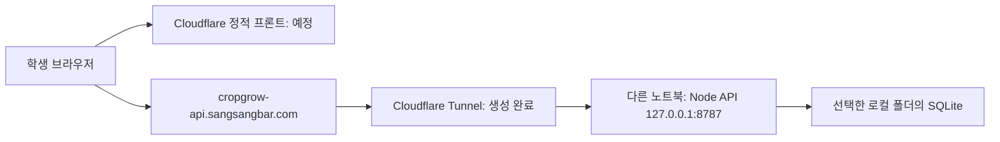

# GrowGame 프로젝트 인수인계

## 2026-11-28 교사용 퀴즈 보고서

교사용 대시보드의 **퀴즈 보고서**에서 과학·영어·역사 전체 정답률, 선택한 과목의 세트별 정답률, 특별 퀴즈 회차별 정답률을 막대그래프로 확인한다. 학년·반 필터와 집계 시각을 표시한다. 각 그래프에 정답 수·제출 문항 수·제출 인원을 표시하고, 일일 퀴즈에는 세트 제출 횟수도 표시한다. 제출 없음과 0%를 구분한다. 일일 퀴즈는 저장된 세트별 점수를 집계한다. 특별 퀴즈는 설문·감사 편지를 제외한 서버 채점 회차를 집계한다. 브라우저 인쇄 메뉴에서 현재 보고서를 인쇄하거나 PDF로 저장할 수 있다.

기능 커밋 `188b954`를 GitHub `main`에 올리고 Oracle `growgame-dashboard`에 배포했다. 운영 SQLite를 읽기 전용으로 열어 세 과목의 제출과 세트 합계, 특별 퀴즈 7개 회차, 학급별 집계와 DB 무결성을 확인했다. 운영 HTTPS에서 보고서 로그인 화면, 비인증 교차 출처 요청 차단, CSS 배포본 일치와 게임 API health를 확인했다.

Flutter 정적 분석·기본 테스트 32개, Node 검사 28개를 통과했다. 격리된 Chrome 320·390·768·1440px에서 로그인, 과목 전환, 학년·반 필터, PDF 저장을 확인했다.

## 2026-11-28 교사용 랭킹·상품 수령 대시보드

교사용 HTTPS 대시보드에서 학생별·반별 수확 순위, 학년·반 필터, 반별 수확 그래프, 일일·특별 퀴즈 정답률을 볼 수 있다. 정답률은 저장된 정답 수를 제출 문항 수로 나눈다. 제출 기록이 없으면 별도로 표시한다. 일일 퀴즈는 기존 채점 요약과 저장된 문제 수, 특별 퀴즈는 서버 채점 결과를 사용한다. 설문과 감사 편지는 정답률 집계에서 제외한다.

**상품 수령**에서 학생 이름·학년·반·번호와 등록한 선생님 이름을 검색한다. 5·10·15개 중 충족한 가장 높은 상품을 확인하고 수령을 확정한다. 수령 시 수확 개수·상품·시각을 운영 SQLite에 저장한다. 행사와 참여자 기준으로 한 건만 기록하며 재가입과 동시 요청에서도 수령 기록을 사용한다. 같은 비밀번호로 여러 브라우저에서 동시에 로그인하며, 로그아웃은 해당 기기의 세션을 끝낸다.

기능 커밋 `a933d24`를 GitHub `main`에 올렸다. Oracle의 `growgame-dashboard` 서비스는 `127.0.0.1:4189`에서 실행하고 Caddy가 `/dashboard/` HTTPS 경로를 전달한다. 서버에서 화면을 생성하며 대시보드 응답은 캐시하지 않는다. 로그인 해시는 서버에 보관한다.

운영 DB를 백업하고 서버의 격리 복사본에서 수령 테이블 추가, 기존 기록 수, 랭킹 쿼리와 무결성을 검증했다. 운영에서 DB 무결성·외래키·수령 테이블·게임 API health를 확인했다. Flutter 분석·기본 테스트 32개와 Node 검사 28개를 통과했다. 격리된 Chrome 320·390·768·1440px에서 학급 필터, 학생·선생님 검색, 수령 확정과 기기별 로그아웃을 확인했다. 운영 HTTPS에서 두 모바일 세션의 동시 로그인, 로그아웃 격리, 공개 게임 출처의 데이터 요청 거절을 확인했다.

## 2026-11-28 11월 30일 상품 수령 로그인 공지

한국 시간 **11월 30일(월) 00:00부터 12월 1일(화) 00:00 전까지** 학생이 로그인하면 **오늘 상품 수령** 공지가 자동으로 뜬다. **점심시간 · 중앙현관**과 수확 작물 ×5 뻥튀기, ×10 과일 젤리, ×15 빼빼로를 안내한다. **닫기**를 누르면 다음 로그인 때 다시 표시한다. **오늘 하루 보지 않기**는 해당 학생과 브라우저에 적용된다.

Flutter 분석·테스트 32개와 Node 검사 27개를 통과했다. 격리 DB와 Chrome 320·390·1920px에서 날짜 전후, 학생과 교사의 차이, 닫기 뒤 재로그인, 하루 숨김 뒤 새로고침과 다른 학생의 공지 표시를 확인했다. 기존 Chrome 게임 통합 검사도 통과했다.

기능 커밋 `19d3e0d`을 GitHub `main`에 올렸다. GitHub Actions `46112462333`과 Cloudflare Pages 운영 배포 `0c804da3-9d8a-44ab-9530-46cbd608eb7e`가 성공했다. 운영 게임 주소의 JS·MJS·Wasm과 공지 이미지 4개를 대조했다. Chrome 첫 방문과 재방문의 로그인 화면 및 운영 API health를 확인했다.

## 2026-11-27 감사 편지의 학생·학급 수신자 선택

관리자 **메시지 전송 → 감사 편지 검토 → 받는 학생·학급 선택**에서 학년·반을 고른 뒤 학생 한 명 또는 **○학년 ○반 전체**로 보낼 수 있다. 편지에 적힌 성함으로 가입한 계정이 없어도 선택할 수 있으며, 등록된 선생님을 함께 지정할 수도 있다. 반 전체는 발송 시점 명단에서 작성자 본인을 제외하고 저장한다. 명단에 있던 미가입 학생은 가입 후 같은 편지를 받는다. **전송 완료**에서 작성자가 적은 성함과 실제 수신자 또는 학급·인원을 확인한다.

Flutter 분석·테스트 31개, Node 백엔드 23개·트래픽/빌드 4개, Oracle 격리 검사 27개와 관리자 Chrome 320·390·1920px 검증을 통과했다. 가상 명단으로 학급 선택 확인·취소, 전체 발송과 일괄 발송, 미가입 수신, 읽음·삭제 격리를 확인했다.

운영 백업 뒤 복사본을 SQLite v16에서 v17로 이관하여 기존 20개 테이블의 기록을 대조했다. 기능 커밋 `31d114b`의 백엔드를 Oracle에 적용했다. 운영 DB 무결성·외래키, 설문 활성 상태, 백업·상태 확인 타이머, API health와 비인증 발송 차단을 확인했다.

기능 커밋을 GitHub `main`에 올렸다. GitHub Actions `45919442312`과 Cloudflare Pages 운영 배포 `a399f589-9e18-48a1-852f-731c065c6823`가 성공했다. Cloudflare와 Oracle의 관리자 주소에서 새 HTML·JS·CSS와 Chrome 390px의 시작 화면·백엔드 연결을 확인했다. 실제 발송은 가상 계정과 별도 DB에서 검증했다.

## 2026-11-26 특별 미션 설문 저장과 성장 보상

관리자 **특별미션 선택 → 설문조사 · 8문항 · 성장 +100%**를 적용하면 참가자가 밭의 **미션 → 특별 미션**에서 설문을 열 수 있다. SQLite v16은 회차를 열 때 문항과 보기를 저장하고, 완성된 응답을 회차당 참가자별로 한 번 기록한다. 보상은 제출과 함께 확정하며 현재 작물에 다 들어가지 않은 영양분은 다음 심기로 이어진다. 관리자 **최근 설문 응답**은 최근 설문 회차의 제출 인원과 보기별 집계를 표시한다.

2026-11-26 20:41(한국 시간), 운영 게임의 특별 미션을 감사 편지에서 **설문조사 11회차**로 전환했다. 운영 SQLite를 다시 열어 활성 회차에 저장된 8문항과 보기가 배포 원본과 일치함을 확인했다. 참가자는 **내 밭 → 미션 → 특별 미션 → 설문 시작**으로 참여한다. 관리자가 같은 설문을 다시 적용하면 새 회차가 열린다.

Oracle에서 운영 DB를 백업하고 복사본을 v15에서 v16으로 이관해 기존 19개 테이블의 기록을 대조했다. 백엔드 배포 후 운영 DB v16의 무결성·외래키, 외부 API와 백업·상태 확인 타이머를 확인했다. Flutter 분석·테스트 31개, Node 검사 26개와 Oracle 격리 검사 25개를 통과했다. 격리된 게임에서 8문항 제출, 같은 회차의 완료 표시 복원과 +100% 보상의 이월을 확인했다.

기능 커밋 `e3d00da`의 GitHub Actions `45812562253`과 Cloudflare Pages 운영 배포 `30ad267e-1317-4586-b306-686612194814`가 성공했다. 실제 게임 주소의 JS·MJS·Wasm을 배포본과 대조하고, 두 관리자 주소에서 설문 메뉴와 배포된 JS·CSS를 확인했다. 운영 게임은 Chrome 첫 방문과 재방문에서 시작 화면을 표시했다.

## 2026-11-26 설문 8문항과 감사 편지 일괄 전송

[특별 미션 설문 미리보기](../previews/survey-mission.html)는 재미, 선호 활동, 첫 이용, 퀴즈 난이도, 불편, 작물에 대한 관심, 원하는 추가 기능, 재참여 의향을 묻는 예시 8문항을 제공한다. 모두 답한 뒤 제출하면 **성장 +100%** 완료 화면을 볼 수 있다. 설문 응답 저장, 실제 성장 보상과 운영 미션 적용은 문항 확정 이후에 연결한다.

관리자 **메시지 전송 → 감사 편지 검토**에서 편지를 체크해 현재 페이지의 최대 20건을 한 번에 전송한다. 선생님께 쓴 편지는 **받는 선생님 선택**을 열어 등록된 선생님을 한 명 이상 체크한다. 수신자 확인에 실패하면 선택한 묶음 전체를 전송 대기로 유지한다. SQLite v15는 작성자가 적은 이름과 실제 수신자를 저장하며 읽음·삭제를 수신자별로 관리한다. 이미 전달한 편지는 기존 수신자와 읽음 상태를 이어받는다.

Flutter 분석·테스트 31개, Node 백엔드 21개, 트래픽·해시 4개와 게임·관리자 Chrome 320·390·1920px 검증을 통과했다. 설문 초안은 Chrome 모바일·가로 화면·PC에서 8문항 제출까지 확인했다. Oracle 격리 검사 24개를 통과했고 운영 SQLite 백업 복사본을 v13에서 v15로 이관하여 기존 기록과 무결성을 대조했다.

운영 DB를 백업한 뒤 커밋 `d1abbb9`의 백엔드를 Oracle에 배포했다. SQLite v15·무결성·외래키, API health, 백업·상태 확인 타이머, Oracle 관리자 화면과 일괄 전송 API의 비인증 차단을 확인했다. 실제 발송 검증에는 격리된 가상 계정을 사용했다.

기능 커밋을 GitHub `main`에 올렸다. GitHub Actions `45754422081`과 Cloudflare Pages 운영 배포 `f0f7ef3a-21f7-4916-a439-79131621954b`가 성공했고, 기존 관리자 주소의 HTML·JS·CSS가 새 배포와 일치함을 확인했다.

## 2026-11-25 행사 상품 안내

내 밭 오른쪽의 **메시지** 아래에서 **상품**을 열 수 있다. Figma 초안의 그림과 배치를 적용했다. 팝업 상단에는 **작물키우기**, 제목에는 **상품**을 표시한다. 수확 작물 ×5 뻥튀기, ×10 젤리, ×15 빼빼로와 **11월 30일 점심시간 · 중앙현관**을 안내한다. 작은 화면에서는 안내를 스크롤할 수 있으며 **내 밭으로**는 하단에 고정한다. 공식 수확 기록은 SQLite를 기준으로 한다.

Flutter 정적 분석·기본 테스트 31개와 Node 검사 24개를 통과했다. 격리 DB와 로컬 Chrome 320·390·1920px에서 메시지 아래 상품 버튼의 위치, 팝업 열기와 닫기, 좁은 화면 스크롤을 확인했다.

기능 커밋 `8bc850b`을 GitHub `main`에 올렸다. GitHub Actions `45549647052`와 Cloudflare Pages 운영 배포 `e77b12ce-4528-4fc8-925b-feed67ecb7a9`가 성공했다. 실제 게임 주소의 JS·MJS·Wasm을 배포 주소와 대조하고 행사 상품 PNG 13개의 내용이 저장소와 일치함을 확인했다. 운영 주소의 Chrome 첫 접속과 재접속에서 로그인 화면을 확인했다.

## 2026-11-23 오전 8시 퀴즈와 특별 미션 회차 유지

검토한 신규 60문제를 운영 문제은행에 추가했다. 과학은 열·기체와 실험 설계, 지구·날씨·태양계, 역사는 선사 시대와 고대 한국, 조선 후기부터 현대 한국까지, 영어는 학교와 프로젝트, 일상과 약속이다. Oracle과 로컬 문제은행의 활성 출제 범위는 과목별 12세트·120문제, 총 36세트·360문제다. 예시 3세트는 비활성으로 유지한다.

일일 퀴즈는 한국 시간 오전 8시부터 다음 날 오전 8시 전까지 과목별 한 세트를 제공한다. 참가자별로 이전에 배정한 세트와 문항을 제외하고 무작위로 배정한다. 같은 기간에 다시 열면 같은 세트를 보여주며, 미수령 보상은 다음 기간에도 받을 수 있다. 세트를 모두 배정받으면 새 문제가 등록될 때까지 기다린다.

특별 미션과 완료 상태는 관리자 웹에서 새로 적용하거나 종료할 때까지 유지된다. SQLite v13은 직접 작성한 특별 미션의 참가자별 완료를 저장하고, 현재 기록에 남아 있던 기존 완료를 이관한다. 운영에서 적용 중이던 학생독립운동기념일 회차와 기존 기록을 보존했다.

Flutter 분석·테스트 31개, Node 검사 24개, 게임·관리자 Chrome 320·390·1920px 검증을 통과했다. 게임에서 오전 8시 안내와 직접 작성 미션의 완료 상태를 확인했다. 실제 문제은행과 가상 참가자 6명으로 216회 배정에 중복이 없음을 확인했다. Oracle 격리 검증 23개, 운영 백업과 복사본의 v12→v13 이관을 확인한 뒤 운영에 반영했다. 운영 DB 무결성·외래키·36세트와 외부 상태 응답, Oracle 관리자 화면을 확인했다.

기능 커밋 `8f5471b`을 GitHub `main`에 올렸다. GitHub Actions `45170764626`과 Cloudflare Pages 운영 배포 `a942bc17-196b-4435-8870-d5c7dea8b605`가 성공했다. 운영 게임 주소의 JS·MJS·Wasm과 관리자 HTML을 배포본과 대조했다. Chrome 390px에서 첫 방문과 재방문 시 시작 화면을 확인했다. 운영 참여자 계정에 대한 풀이·보상 검증은 격리 환경에서 수행했다.

## 2026-11-20 특별 미션 알림과 메시지 관리

관리자가 특별 미션을 적용하면 밭의 **미션** 버튼과 선택 화면의 **특별 미션**에 금색 **새 미션** 표시가 붙는다. 현재 로그인에서 특별 미션을 열면 강조가 사라지고, 새 회차를 적용하면 다시 나타난다. 진행 중인 특별 미션이 없으면 퀴즈 미션만 표시한다. 입장·복귀와 미션 선택 화면을 열 때 서버 상태를 확인하며, 밭을 열어 둔 경우 기존 60초 주기로 갱신한다.

관리자 **메시지 전송 → 보낸 관리자 메시지**에서 기존·신규 발송의 대상·한국 시간 기준 발송 시각·본문을 확인한다. 전달한 감사 편지는 **감사 편지 검토 → 전송 완료**에서 확인한다. 학생과 선생님은 받은 메시지를 펼친 뒤 **삭제 → 삭제하기**로 본인 받은함에서 지울 수 있다. SQLite v12는 계정별 삭제 상태를 저장한다. 전체 공지는 다른 수신자에게 계속 보이며 발송 내역과 감사 편지 보상을 보존한다.

Flutter 분석·기본 테스트 31개·로컬 체험 1개, Node 검사 22개, 게임·관리자 Chrome 320·390·1920px 검증을 통과했다. 격리 DB에서 회차 갱신, 발송 이력, 삭제 취소·확정, 재로그인, 수신자 격리와 마지막 페이지 삭제를 확인했다. Oracle 격리 테스트 21개, 운영 백업과 복사본 v11→v12 이관을 통과했다. 기능 커밋 `2b51840`의 백엔드를 운영에 적용한 뒤 SQLite v12 무결성·외래키, 상태 확인·백업 타이머, 외부 health와 신규 API 비인증 차단을 확인했다.

기능 커밋 `2b51840`을 GitHub `main`에 올렸다. GitHub Actions `44721519965`와 Cloudflare Pages 운영 배포 `e52c6ed0-0f32-450b-99b8-d7a1fc837838`가 성공했다. 실제 게임 주소의 JS·MJS·Wasm이 배포본과 일치하고, Chrome 390px 첫 방문·재방문에서 게임 시작 화면을 확인했다. Cloudflare와 Oracle 관리자 주소에서 새 메뉴 HTML과 동일한 JS·CSS 내용을 확인했다. 메시지 발송·삭제 검증은 격리된 가상 계정으로 수행했다.

## 2026-11-20 가입 전 관리자 메시지 발송

관리자 **메시지 전송 → 관리자 메시지 작성**에서 전체 또는 학생·선생님 한 명에게 보낼 수 있다. 전체 공지는 발송 뒤 처음 가입한 학생과 선생님도 게임 메시지함에서 확인한다. 학생은 가입 여부와 관계없이 명단의 학년·반·번호로 선택하며 선생님은 가입할 때 쓸 이름으로 지정한다. SQLite v11은 메시지를 수신 대상별로 저장하고 읽음은 계정마다 기록한다. 기존 감사 편지는 같은 메뉴의 **감사 편지 검토**에서 전달한다.

Flutter 분석·테스트 31개, 로컬 Node 검사 22개와 Chrome 관리자 320·390·1920px 검증을 통과했다. 가상 계정으로 가입 전 전체·개인 발송과 가입 후 조회·읽음, 수신자 권한 격리, 재시도와 감사 편지 전달을 확인했다. Oracle 격리 테스트 21개 및 운영 DB 백업을 통과한 뒤 기능 커밋 `a24ce4d`의 백엔드를 운영 서버에 적용했다. DB v11 무결성·외래키와 로컬 health, 백업·상태 확인 타이머를 확인했다.

GitHub Actions `44684258789`와 Cloudflare Pages 운영 배포 `506b4c3a-bb92-49fe-84da-09ca18efe1c2`가 성공했다. Cloudflare와 Oracle의 관리자 주소 두 곳에서 새 HTML과 동일한 관리자 JS 응답을 확인했다. 외부 health와 발송 대상 API의 비인증 차단도 확인했다. 발송 검증은 격리된 가상 계정으로 수행했다.

## 2026-11-19 전체 검증과 일일 퀴즈 수정

일일 퀴즈 채점 요청을 Chrome에서 일시 정지하고 창을 닫았을 때 기존 웹은 응답 후 성장 보상을 요청하지 않았다. 채점 완료를 기다린 뒤 한 번 지급하도록 수정했다. 과목 목록은 날짜가 넘어간 미수령 보상과 소진된 과목을 구분한다. 새로 배정할 세트는 ID를 먼저 선택하고 해당 세트의 문제만 배정 기록에 복사한다. 이전에 풀었던 문제와의 중복 검사는 유지한다.

실제 30세트 문제은행으로 동일한 임시 DB에서 과목 목록 조회를 전후 비교했다. 250회씩 7번 측정한 회당 시간의 중앙값은 과목별 완료 0세트에서 0.311→0.118ms, 5세트에서 0.770→0.779ms, 10세트에서 0.738→0.354ms였다. 로컬 백엔드 부하 검사에서 가상 학생 100명씩 3회 신규 등록·물주기·재로그인 900건이 통과했다. 별도의 200명 동시 시험에서 등록부터 과학 세트 배정, 일일·기념일 퀴즈, 수확과 두 번의 심기, 재전송, 랭킹까지 13단계 2,600건이 통과했다. 첫날 과학 10개 세트가 모두 배정됐다. 신규 등록 p95는 1.144초였다. 학교 무선망의 실제 기기는 이번 측정 범위 밖이다.

Flutter 분석·기본 테스트 31개와 로컬 체험 모드 1개, Node 검사 21개를 통과했다. Chrome 게임 통합 검사에서 이전 웹은 채점 중 닫기 시 실패했고 수정본은 보상 요청 1회·이월 100%를 확인했다. 관리자, 모바일·PC 게임 흐름과 체험 모드의 Wasm·JS 대체 실행도 검증했다. 운영 문제은행 300개와 기념일 30개의 보기·정답 범위·해설을 검사했다. 배포 게임 이미지 89개·포스터 3개·폰트 2개의 SHA-256이 빌드 결과와 일치했다.

Oracle에서 Node 검사 20개를 통과하고 운영 DB 백업 성공 후 퀴즈 모듈을 적용했다. 운영 백엔드 파일 13개의 내용이 로컬 릴리스와 일치했다. DB v9의 무결성·외래키, 활성 세 과목, 백업·상태 확인 타이머, 외부 health와 관리자 두 주소를 확인했다.

기능 커밋 `14b34e0`의 GitHub Actions `44508663641`과 Cloudflare Pages 운영 배포 `c1e6b308-453a-4e39-a7ed-5fadf2902a1e`가 성공했다. 실서비스 JS·MJS·Wasm이 배포본과 바이트 단위로 일치했다. 현재 PC의 실제 네트워크에서 Chrome 390px 로그인 전 첫 화면을 첫 접속·재방문 각각 3회 측정했다. 첫 프레임 중앙값은 869ms와 300ms였고 재방문 시 해시가 붙은 앱·폰트·이미지 파일은 브라우저 캐시를 사용했다.

## 2026-11-19 퀴즈 영양분 이월과 다시 심기

일일 퀴즈에서 작물의 100%를 넘었던 보상을 SQLite v9의 `quiz_runs.reward_remaining`에 보관한다. 기념일 퀴즈와 감사 편지의 기존 잔액도 같은 심기 요청에서 지급한다. 씨앗 하나에 100%까지 넣고 남은 양은 다음 심기까지 보관한다. 채점을 마치고 결과를 닫기 전에 접속이 끊긴 일일 퀴즈도 다음 심기에서 수령한다. 밭에는 대기 중인 영양분이 표시되고, 새 씨앗을 심으면 뿌리 흡수 효과와 함께 성장 게이지가 올라간다.

운영 문제은행과 분리한 테스트 DB에서 가상 학생 20명의 첫날 배정은 과학 6종·역사 9종·영어 8종이었다. 같은 학생이 같은 날 다시 열면 같은 세트였고 한 학생의 10일간 배정은 과목별 10세트씩 중복이 없었다. SQLite가 각 학생의 미완료 세트 중 하나를 무작위로 선택한다. 신규 참여자는 이전 풀이와의 비교에 필요하지 않은 문제 본문 파싱을 생략한다. 보상 잔액 조회에 사용하는 인덱스를 운영 DB의 쿼리 계획으로 확인했다.

Flutter 분석·테스트 31개와 별도 로컬 체험 테스트, Node 테스트 21개, 관리자·게임 Chrome 검증을 통과했다. 농업인의 날 퀴즈 → 수확 → 고구마 심기에서 남은 40% 안내·흡수 효과·최종 성장도 40%를 확인했다. 서버 테스트로 재시도 시 중복 방지, 빈 밭에서 보상 받기와 두 번의 심기에 걸친 이월도 검증했다.

기능 커밋 `8a62868`을 GitHub main에 올렸다. Oracle에서 Node 검사 20개, 서버 백업, 백업 복사본의 v8→v9 이관과 기존 기록 대조를 통과했다. 운영 서비스에 반영한 뒤 DB v9·무결성·외래키·활성 30세트, 외부 health, 관리자 두 주소를 확인했다.

GitHub Actions `44506544047`과 Cloudflare Pages 운영 배포 `2b7a9630-5f59-472d-b63e-d154ff779ec4`가 성공했다. 게임 도메인의 JS·MJS·Wasm 파일명이 이번 배포본과 일치하고 세 파일 모두 HTTP 200이었다. 실제 도메인에서 Chrome으로 첫 접속과 재방문 시 로그인 화면을 확인했다. 게임 쓰기 동작은 가상 학생과 격리된 DB에서 시험했다.

## 2026-11-18 Cloudflare 관리자·연결 상태·트래픽·자동 복구 완료

후속 사용자 요청: 관리자 웹을 Cloudflare 도메인에서 열고 백엔드 연결 상태와 사용 트래픽을 표시한다. 기존 학생/교사 기록 삭제·PIN 변경·특별미션·메시지 전송은 유지한다. 서버 오류 시 자동 복구를 원하며, Dots의 클라우드 컴퓨터로 관리 가능한지도 질문했다. 관리자 기본 주소를 `https://cropgrow.sangsangbar.com/admin/`로 정했다. Oracle 직접 관리자 `/admin/`도 계속 제공한다.

`scripts/finalize-web.cjs`가 기존 `backend/admin` 파일을 정적 빌드 `/admin/`로 복사하고 API origin을 HTML 메타데이터와 CSP에 넣는다. 관리자 파일은 no-store이며 API 요청은 Oracle로 직접 전송한다. 허용된 프론트 Origin에서 관리자 API에 접근하도록 CORS를 변경했지만 별도 관리자 인증과 학생 세션 거부를 유지한다. 연결 배지는 로그인 전에도 15초마다 확인하고 다시 확인 버튼을 제공한다. 네트워크 실패는 서버 전원 꺼짐으로 단정하지 않고 응답 없음으로 표시하며, 서버 중단 중에도 Cloudflare 관리자 페이지를 열 수 있다.

관리자 인증 후 월간 송신·수신 바이트와 무료 outbound 기준 10TB 대비 비율을 표시한다. Linux의 루프백 제외 네트워크 인터페이스 카운터를 참고 집계하며 Oracle 청구량과 다를 수 있음을 화면에 명시한다. `backend/traffic.cjs`가 현재 UTC 월의 집계를 서버 로컬 `server-traffic.json`에 원자적으로 저장한다. 재시작·재부팅·월 변경을 처리하며 수집 불가/손상은 0이 아닌 수집 불가로 반환한다. 이전 달부터 켜진 서버의 최초 실행은 수집 이후 증가량만 센다. 공개 health는 DB 조회 성공도 확인한다. 학생 DB 스키마·기록 정책은 바꾸지 않았다.

로컬 백엔드 17개·트래픽 3개·빌드 해시/관리자 패키징 1개 통과. Chrome의 별도 정적 프론트→별도 API 구성에서 320/390/1920px 기존 관리 기능 전체, 트래픽 표시·학생/관리자 인증 분리·백엔드 중단 시 마지막 사용량 보존·중단 중 새 페이지 로딩·복구를 확인했다. 화면 캡처를 검토했다. 이전 Flutter analyze·test 31개와 게임 Chrome 직접 API 검증도 통과했다. 기능 커밋 `15b57e0636bf87f8b8261de39102f8f648a5b910` main push·Oracle 적용·재시작 완료. GitHub Actions `44128616607` 성공, Pages `32c3c109-edef-4a21-9eb0-c8e5d04294fc` 배포 성공과 uses_functions=false를 확인했다.

실제 `https://cropgrow.sangsangbar.com/admin/`과 JS·CSS 응답, Oracle API 메타데이터·CSP·no-store를 확인했고 새 Chrome 프로필의 읽기 전용 실제 브라우저에서 백엔드 연결됨 표시와 화면을 검토했다. 실제 게임 도메인의 JS가 직접 Oracle API 주소를 포함하며 Wasm/MJS/JS HTTP 200도 확인했다. Oracle ARM에서도 백엔드 17개·트래픽 3개가 통과했다. 실제 관리자 트래픽 API의 비인증 401·프론트 CORS 204, 네트워크 집계 파일의 실측 값 저장을 확인했다. 실제 관리자 비밀번호를 이용한 운영 로그인·실제 학생 기록의 변경/삭제는 하지 않았으며 쓰기 기능은 격리된 DB로 검증했다.

Oracle의 `growgame.service`는 예상치 않은 종료 시 3초 뒤 재시작하도록 Restart=always를 설정했다. `growgame-healthcheck.timer`는 매분 로컬 health를 확인하고 curl 재시도 2회까지 실패하면 `growgame-recover.service`로 백엔드를 재시작한다. 설정 검증과 정상 health check 실행을 확인했다. 실제 참여자가 0명인 것을 확인한 뒤 해당 Node 메인 프로세스만 SIGKILL로 종료해 자동 복구를 시험했다. NRestarts 0→1, health 복구·SQLite integrity_check 정상·참여자 0명·명단 990명 보존을 확인했다. VM 전체의 강제 재부팅은 설정하지 않았으며, Oracle VM 회수·전원 중단까지 복구하는 장치는 아니다. 의도적으로 백엔드를 중지하려면 먼저 healthcheck.timer도 중지한다.

다른 PC는 그 PC에서 별도 SSH 키를 생성해 공개 키만 서버 authorized_keys에 등록한다. Dots는 공식 문서상 자체 클라우드 컴퓨터·셸 네트워크 권한을 제공하므로 허용된 환경과 별도 전용 SSH 키가 있으면 관리 구성이 가능할 것으로 설명했다. 실제 Dot 연결·새 접근 키 발급은 하지 않았으며 추가 사용량 비용 0원을 보장하지 않는다. 기존 개인 키를 클라우드나 채팅에 올리지 않는다.

검증용 정적 서버와 Oracle 부하 시험 도우미를 종료·정리하고 R: 별칭도 해제했다. 스크린샷·원시 부하 보고서는 임시 폴더에 남긴다. 새 실제 사이트 읽기 검증의 임시 Chrome 프로필 폴더 삭제는 자동 승인 검토에서 정책상 차단되어 보존했다. Git 유지보수에서 경고하던 오래된 빈 packed-refs.lock은 Git 프로세스가 없는 것을 확인하고 임시 백업으로 이동했다. 사용자의 기존 `.ua/` 미추적 폴더는 그대로 두었다. 최종 완료 기록은 `[skip ci]` 문서 커밋으로 저장한다. 짧은 주기의 게임 랭킹 갱신은 아직 60초이며 학교 Wi-Fi 200대 실측·서버 밖 정기 백업 자동화는 별도 남은 항목이다.

## 2026-11-18 Oracle 백엔드·새 DB·직접 API 전환 완료

사용자는 백엔드를 Oracle 무료 계정으로 이전하고, 학생 약 200명이 동시 참여하는 일주일 행사를 운영할 계획이다. 유료 계정 업그레이드 없이 Always Free 범위만 사용한다. Cloudflare Pages는 정적 프론트를 제공하고 브라우저는 Oracle API에 직접 요청한다. 기존 Pages Functions API 중계와 Tunnel은 새 경로에서 사용하지 않는다. 사용자는 **기존 운영 기록 없이 새로 시작**하도록 명시했다. 기존 노트북 DB는 보존하며 관리자 웹의 학생/교사 기록 삭제·PIN 변경·메시지 전송과 관리자 비밀번호 설정을 유지한다.

Oracle 인스턴스 `cropgrow`, 공인 IPv4 `158.101.141.124`에 SSH 접속했다. ARM aarch64·2코어·RAM 11,924MiB·Ubuntu 26.04.1 LTS·루트 디스크 약 45GiB를 확인했다. 개인 키의 Windows ACL이 너무 넓어 첫 접속이 거절되어 현재 사용자만 읽도록 제한한 뒤 성공했다. 키는 프로젝트 밖 로컬 파일이며 원문을 출력하거나 Git에 넣지 않는다. 콘솔 자동화는 도구가 Windows 브라우저 URL을 확인하지 못해 중단했다. 사용자가 직접 Oracle 보안 목록에 80·443을 허용했고 OS 방화벽에도 같은 두 포트를 허용·영구 저장했다. 8787은 외부에 공개하지 않는다.

공식 ARM Node.js 24.22.3(SHA-256 확인), Caddy 2.11.9와 프로젝트 `/opt/growgame`을 설치했다. 전용 사용자 `growgame`과 `growgame.service` 자동 시작을 설정했다. 새 DB `/var/lib/growgame/growgame.sqlite`는 SQLite v7·참여자 0명·명단 990명·integrity_check 정상이다. CSV·문제은행·관리자 해시 설정을 SCP로 이전했으며 학생·비밀 자료는 Git에 넣지 않았다. 관리자 페이지 HTTP 200, 비인증 학생/교사 관리 API 401, 프론트 Origin의 CORS preflight 204를 확인했다. Oracle ARM에서도 백엔드 테스트 16개가 모두 통과했다.

API DNS 레코드 `053fba0a65660fed4b7142402de89cb8`을 기존 Tunnel CNAME에서 A `158.101.141.124`·DNS only·TTL 300으로 전환했다. Caddy의 자동 HTTPS를 활성화했으며 실제 API 도메인의 인증서 검증을 포함한 health 200·관리자 페이지 200·CORS preflight 204를 확인했다. Caddy는 `/etc/caddy/Caddyfile`에서 `127.0.0.1:8787`로 전달한다. 관리자 주소는 `https://cropgrow-api.sangsangbar.com/admin/`이다. 기존 노트북 API·Tunnel·DB는 변경하지 않았다.

`growgame-backup.timer`는 매일 한국 시간 03:00에 `/var/backups/growgame`으로 SQLite 백업한다. 첫 백업 성공, 이 PC의 `%LOCALAPPDATA%/growgame-oracle-backups`로 SCP 복사와 양쪽 SHA-256 일치를 확인했다. 서버 밖 정기 백업은 아직 자동화하지 않았다.

프론트와 두 빌드 경로의 기본 API 주소를 `https://cropgrow-api.sangsangbar.com`으로 변경하고 Pages Functions 중계·전용 테스트·CI 실행을 제거했다. 직접 요청의 CORS·인증·no-store·중복 보상 회귀 검사를 보강했다. 실제 Pages production/preview의 `API_BASE_URL` 변경도 완료했다. 로컬 Flutter analyze·Flutter test 31개(전용 로컬 1개 제외)·백엔드 16개·해시 1개 통과. 한글 경로의 기존 Dart 분석 오류는 비어 있던 R: 별칭에서 재실행해 해결했다. Wasm+JS 로컬 빌드와 임시 DB·별도 API 포트의 Chrome 직접 연결 검증도 통과했다. 명단·교사·퀴즈·성장·수확·랭킹·복구·학생/교사 메시지·읽음·기념일 미션 및 3가지 화면 크기를 확인했다. 커밋 `be7b8ef289f78b4a225ea114656b8f9457b65b63` main push, GitHub Actions `44125456445` 성공, Pages `a390e816-7722-48d6-ac1b-341bea5d970e` 배포 성공 및 uses_functions=false를 확인했다. Oracle 코드도 해당 커밋으로 갱신했다.

랭킹은 현재 약 60초 자동 갱신이며 요청마다 집계한다. 더 짧은 갱신이나 즉시 알림은 아직 구현하지 않았다. 200명이 5초마다 조회하면 랭킹만 시간당 144,000건이므로 직접 API로 전환하여 Pages Functions 무료 일일 한도를 사용하지 않게 한다. 진단 스크립트의 상한을 100→200으로 늘리고 Oracle 내부의 격리된 임시 DB에서 200명 동시 신규 등록 3회를 측정했다. 실패 0/600·각 해시 200회·최종 각 200명으로 통과했다. 회차별 최장 3.962/3.897/3.909초, p95 3.793/3.738/3.731초, RSS 최고 약 155MiB였다. 인터넷·학생 Wi-Fi를 포함한 성능 보장은 아니며 실제 플레이·잦은 랭킹 부하와 학교 Wi-Fi 실측은 남아 있다. 하루 한 번 접속만으로 유휴 회수 제외를 보장하지 않는다. Oracle 월 무료 outbound 한도는 공식 문서 기준 10TB이다.

## 2026-11-17 선생님 기록 삭제·비밀번호 변경

사용자가 관리자 선생님 기록에 삭제와 비밀번호 변경을 추가 요청했다. 선생님 표에 PIN 설정 여부·변경·삭제 버튼을 추가하고 기존 학생 확인 창을 함께 사용한다. 새 PIN은 숫자 4자리이며 원문을 조회하거나 저장하지 않는다. 변경 시 해당 계정의 로그인만 해제하고 재배·수확·퀴즈·메시지 기록을 보존한다. `POST /api/admin/reset-pin`은 `{profile:{role:'teacher',name},pin}`을 지원한다.

삭제는 성함과 되돌릴 수 없다는 경고를 표시하고 취소 버튼에 먼저 포커스를 둔다. `POST /api/admin/delete-teacher`의 `{name}`을 관리자 인증·동일 Origin 확인 후 처리한다. 이름은 로그인과 같은 trim+NFC·1~50자 검증을 사용한다. 계정·세션·재배·수확·퀴즈·보낸 감사 편지를 한 트랜잭션으로 삭제한다. 다른 사람이 해당 이름으로 보낸 감사 편지는 발신자의 기록으로 보관하며 관리자에 등록 안됨으로 표시한다. 동일 성함 재참여 시 게임은 새 계정으로 시작하고 보관된 받은 편지는 기존 이름 수신 규칙을 따른다. DB 스키마 변경은 없다.

Flutter analyze 이상 없음, Flutter test 31개(로컬 전용 1개 제외), 백엔드 16개·해시/프록시 3개 통과. 임시 DB에서 PIN 변경·권한·모든 기존 세션 해제·기록 보존·삭제 롤백·관련 7개 테이블 정리·이름 정규화·재등록 및 진행 중 로그인/PIN 변경 차단을 확인했다. 관리자 Chrome 320/390/1920px에서 선생님 PIN 변경·삭제 취소·확정·기록/통계 갱신·학생 기록 보존을 통과하고 삭제 확인 창 및 PC 표 스크린샷을 검토했다.

기능 커밋 `7c08b0bd05fa22c3b5ecf53f8c10731f93927ff5` GitHub main push 완료. Actions `44035590856` 전체 성공, Pages `16ebee55-f27a-4137-8d25-2cbddb0f1e67` 배포 성공. 게임 도메인과 새 배포 주소의 HTML 앱 파일명 일치, Wasm/MJS/JS HTTP 200을 확인했다. 검증용 API·Chrome과 R: 별칭은 정리했다. 관리자 기능은 백엔드 재시작 후 적용된다. 운영 API·Tunnel·실제 DB는 변경하지 않았다. **운영 노트북의 DB 백업·최신 코드 적용·GrowGame 시작.cmd 재실행 및 운영 DB 최종 확인은 남아 있다.** 완료 기록은 `[skip ci]` 문서 커밋으로 저장한다.

## 2026-11-17 순국선열 포스터 교체·부가 문구 삭제·선생님 기록 조회

사용자가 첨부한 800×904 순국선열의 날 포스터를 `assets/posters/patriots.png`에 원본 그대로 저장하고 기존 순국선열 포스터 머리말 대신 표시한다. 비율을 유지하며 자르지 않는다. 순국선열의 날·농업인의 날 모두 키워드 나열과 하단 출처 문구를 화면에서 제거했다. 퀴즈에 필요한 학습 본문·10문제·정답·보상과 기존 회차의 SQLite 스냅샷은 유지한다.

관리자 **선생님 기록** 탭에서 성함·현재 작물·성장도·총 수확과 선생님 전체 합계를 조회한다. 별도 관리자 인증이 필요한 `GET /api/admin/teachers`를 사용하며 이름과 작물·성장·수확 요약만 반환한다. 학생 학년·반 필터와 집계를 분리하고, 새로고침과 탭 진입 시 최신 SQLite 기록을 읽는다. DB 스키마 변경은 없다.

Flutter analyze 이상 없음, Flutter test 31개(로컬 전용 1개 제외), 백엔드 15개·프록시 2개·해시 1개 통과. 관리자 Chrome 320/390/1920px의 선생님 기록·통계·빈 목록·새로고침·학생 관리·메시지 전송을 통과했다. Wasm+JS 빌드와 임시 DB·8788 API의 게임 Chrome 전체 검증도 통과했다. 두 기념일의 3가지 화면, 새 이미지·부가 문구 없음·본문·10문항 채점·영양분 효과·중복 보상 방지를 확인하고 스크린샷을 검토했다.

기능 커밋 `1352abd449476b3a2a59bd2548f62e5df3e3f026` GitHub main push 완료. Actions `44033710964` 전체 성공, Pages `37f71279-0eb3-400f-ab95-c22209fab670` 배포 성공. 게임 도메인과 배포 주소의 HTML 앱 파일명 일치 및 Wasm/MJS/JS HTTP 200을 확인했다. 배포된 포스터도 HTTP 200이며 로컬 첨부 원본과 SHA-256이 일치한다. 검증용 API·정적 서버·Chrome과 R: 별칭은 정리했다. 운영 API·Tunnel과 실제 DB는 시작하거나 변경하지 않았다. **운영 노트북의 DB 백업·최신 코드 적용·GrowGame 시작.cmd 재실행 및 운영 DB 최종 확인은 남아 있다.** 완료 기록은 `[skip ci]` 문서 커밋으로 저장한다.

## 2026-11-16 영양분 효과·읽기·모바일 키보드·선생님 수신 (최신 작업)

사용자는 특별 퀴즈도 일반 퀴즈처럼 영양분 흡수 효과를 추가하고 단어 단위 줄바꿈, 안 읽은 메시지 개수·테두리 강조와 읽으면 강조 해제를 요청했다. 추가로 모바일 감사 메시지 입력 시 게임 전체가 축소되지 않고 키보드 위로 입력칸이 올라오도록 수정하며, 받는 사람에 선생님을 골라 성함으로 보낼 수 있게 요청했다. 미등록 선생님은 관리자 웹에 **등록 안됨**을 표시한다.

특별 퀴즈 서버 확정 보상을 결과 창을 닫을 때 기존 영양분 효과로 표시하고 결과 재열기는 반복하지 않는다. 제출 중 창을 닫아도 응답까지 다른 성장 입력을 막고 저장 보상·효과를 한 번 이어간다. WordText는 원문·접근성 이름을 유지하면서 단어 단위 줄바꿈하고 한 줄보다 긴 단어만 나눈다. 키보드 여백을 논리 화면 배율로 환산하고 두 Scaffold의 자동 축소를 끄며, SafeArea 하단 제스처 여백도 유지한다. 감사 내용·받는 선생님 성함 입력칸은 포커스·키보드 변화 때 화면 안으로 스크롤한다. 읽음은 개별 메시지를 펼쳤을 때만 DB에 저장하며 본문은 보관한다.

SQLite v7은 recipient_role과 read_at을 포함하고 기존 메시지·학생·보상·읽음 기록을 보존한다. 선생님 수신 이름은 로그인과 동일하게 trim+NFC 처리한다. 아직 가입하지 않은 이름도 작성·보상은 허용하지만 관리자 전송은 같은 이름으로 선생님이 가입한 뒤 가능하다. 학생·선생님 합산 서로 다른 4명 제한과 본인 발송 금지를 유지한다. 수신자 역할·학급 또는 선생님 이름으로 메시지·안 읽은 개수를 제한한다.

Flutter analyze 이상 없음, Flutter test 31개(로컬 전용 1개 제외), 백엔드 15개와 프록시/해시 3개 통과. 기존 v4/v5/v6 메시지의 id·본문·전송·읽음·보상 보존, 학생/교사 수신 격리, 이름 정규화·본인/중복 차단·4명 제한·미등록 보관·가입 후 전송을 임시 DB로 확인했다. 관리자 Chrome 320/390/1920px의 미등록 표시·전송 상태·학생 및 교사 받은함 확인 통과. 게임 Chrome에서도 학생/교사 편지 작성·수신·읽음 강조 제거, 두 특별 퀴즈 영양분 효과·재열기 중복 없음·제출 응답 전 닫기 중 다른 성장 입력 차단과 응답 후 효과를 통과했다. 포스터·문제·결과·알림·효과 스크린샷을 검토했다. 모바일 키보드는 320/390px 및 하단 제스처 여백 34px의 가상 viewInsets로 배율 유지·입력칸 노출·본문 유지 테스트를 통과했다. 실제 휴대폰 OS 키보드는 직접 검증하지 못했다.

기능 커밋 `1256277af721dc01fd1583e15344d038d301aff8` GitHub main push 완료. Actions `43851128372` 전체 성공, Pages `62dd6070-9366-420c-a43c-a0909c3d2016` 배포 성공. 게임 도메인과 배포 주소의 HTML 파일명이 일치하고 Wasm/MJS/JS 모두 HTTP 200을 확인했다. 검증용 API·Chrome·정적 서버는 정리했다. 운영 API/Tunnel과 실제 DB는 이번 작업에서 시작하거나 변경하지 않았다. **운영 노트북의 DB 백업·최신 코드 적용·GrowGame 시작.cmd 재실행 및 운영 DB 최종 확인은 남아 있다.** 새 메시지·선생님 수신·읽음 상태·보상은 서버 로컬 SQLite에 저장하고 구글 드라이브에는 프로젝트 코드와 원본 편집 파일을 보관한다. 완료 기록은 `[skip ci]` 문서 커밋으로 저장한다.

## 2026-11-16 특별미션 3종·감사 메시지 SQLite 단독 저장 (최신)

사용자는 순국선열의 날과 농업인의 날에 대해 포스터·설명·각 10문제를 추가하고, 관리자에서 감사 편지와 함께 선택하도록 요청했다. 보상은 정답당 10%, 최대 100%로 확정했다. 추가로 노션 미등록과 전송 버튼 대기를 지적한 뒤 **노션 저장을 취소하고 SQLite 저장·관리자 수동 전송만 유지**하도록 최종 결정했다. 이전 노션 연동 지시는 이 결정으로 대체한다.

기본 미션 3종과 기존 직접 작성·종료를 지원한다. 한 번에 하나를 적용하고 회차마다 학생별 퀴즈 1회, 감사 편지 4명 제한을 새로 계산한다. 포스터의 설명에서 모든 문제의 답을 찾을 수 있고, 학습 → 문제 풀기 → 10문항 → 정답/오답/해설 순서다. 퀴즈는 서버 채점이며 최초 제출 결과를 고정하고 중복 보상을 막는다. 작물의 100%를 넘는 보상은 다음 심기로 이어진다.

SQLite v5는 special_campaigns의 기존 id와 감사 메시지 연결을 유지하면서 미션 종류·content_json을 확장하고 special_quiz_results를 추가한다. 원고 backend/commemorative-missions.cjs를 관리자 적용 시 DB로 복사하여 회차별 정답을 고정한다. 국가기록원·국가보훈부·농림축산식품부 자료를 확인했다. 감사 메시지는 관리자에서 본문을 읽고 전송한다. 노션 클라이언트·자동 동기화·전송 전 노션 등록 조건은 제거했다. 과거 노션 관련 DB 열은 호환용으로만 보존한다. 실제 학생 메시지를 자동 전송하지 않는다.

로컬 analyze, Flutter test 22개(로컬 전용 1개 제외), 백엔드 12개, 프록시/해시 3개, Wasm+JS 빌드 통과. 관리자와 학생 Chrome에서 320/390/1920px 포스터·미션 선택·DB 메시지 수동 전송을 확인했다. 두 기념일 모두 10문항 실제 풀이·7개 정답의 70% 결과·해설 화면까지 통과했고 스크린샷도 검토했다. v4 이전·기존 메시지 전송·재시도·교체·0/70/100% 보상·남은 보상·재접속·삭제 FK는 임시 DB로 검증했다.

기능 커밋 `6a6eec701ccb8d8cc373c923d6caa1c0bbc85a4a`를 GitHub main에 push했다. Actions `43847804394` 전체 성공, Pages `eabb8c18-c038-4aad-abb3-e8b999d487c2` 배포 성공. 실제 게임 도메인의 HTML 파일명과 배포 주소가 일치하고 Wasm/MJS/JS HTTP 200을 확인했다. 현재 PC 설정은 %LOCALAPPDATA%/growgame-test-data이며 C:/scr/grow 운영 DB는 이 PC에 없다. 운영 API/Tunnel은 시작하지 않았고 검증용 API·정적 서버·Chrome은 정리했다. **운영 노트북의 최신 코드 적용·DB 백업·재시작과 운영 DB에서의 최종 확인은 남아 있다.** 노션 관련 기존 외부 페이지와 로컬 인증 파일은 삭제하지 않았지만 새 서버 코드는 읽거나 전송하지 않는다. 완료 기록은 `[skip ci]` 문서 커밋으로 저장한다.

## 2026-11-16 감사 특별미션·노션 검토·관리자 전송

사용자 요청은 관리자 화면에서 특별미션을 누를 때마다 즉시 교체하고, 첫 미션으로 학생 학년·반·번호를 선택해 10글자 이상 감사 메시지를 작성하는 기능이다. 한 번 적용한 미션마다 서로 다른 4명, 메시지당 성장도 25%이며 남은 보상은 다음 작물에 이어서 적용한다. 노션에서 검토 후 관리자 페이지의 전송 버튼으로 학생 메시지함에 전달한다. 지정한 저장 위치는 미래교육 → 작물 메세지 페이지다.

노션 페이지 `41a17b13-a52b-80f6-b8f2-f7750ffcd2a8` 아래 감사 메시지 검토함 DB `41a17b13-a52b-8176-80a0-e2be918ccddc`, 데이터 소스 `41a17b13-a52b-81aa-a4d4-000b8b8028d4`를 만들었다. 보낸 사람·받는 학생·본문·검토 상태·제출/전송 시각·기록 ID·검토 메모를 저장한다. 실제 API의 생성·전송 상태 반영을 확인했고 검증용 행은 보관함으로 정리했다. 키는 Windows DPAPI의 로컬 notion-token.clixml에 암호화하고 연결 대상은 로컬 notion-config.json에 저장했다.

SQLite v4, 신규 특별미션·감사 메시지 API, 노션 재시도 큐, 관리자 선택/전송 UI, Flutter 작성창/받은 메시지함을 구현했다. Flutter analyze 및 Flutter test 22개(로컬 전용 1개 제외), 백엔드 11개와 프록시/해시 3개 검사가 통과했다. Chrome에서 작성·25% 보상·노션 저장 후 관리자 수동 전송·받는 학생의 메시지 확인을 통과했다. 관리자 선택·전송 UI는 320/390/1920px에서 통과했으며 작성창·받은 메시지·관리자 스크린샷을 확인했다. 최신 빌드에서 직접 작성한 특별미션으로 교체하고 30%를 받는 흐름도 통과했다. 운영 API·Tunnel은 사용자 요청에 따른 종료 상태다.

기존 로컬 DB를 백업한 뒤 v4로 이전하고 첫 감사 미션을 선택했다. 학생·수확·퀴즈 개수 일치와 FK 오류 0건을 확인했다. 다음 서버 실행부터 사용할 수 있다. 미션을 다시 적용할 때마다 새로운 id로 4명 제한을 계산하고, HTTP 재시도는 같은 요청 번호로 재적용을 막는다. 메시지와 보상을 SQLite 트랜잭션으로 확정하고 남은 영양분은 다음 심기로 넘긴다. 노션은 기록 ID 조회 후 저장하며 저장 대기·전송 상태를 30초마다 동기화한다. 학생 받은함은 본인 학년·반·번호의 전송 완료 메시지만 20개씩 조회한다.

기능 커밋 `3a3848c663d740ab1144e523474260fd3a7dd225`를 GitHub main에 push했다. Actions `43828240198` 성공, Pages `2e17d78f-d8d9-4ffa-a8b7-47c21f37bcfd` 배포 성공과 실제 게임 도메인 HTML의 앱 파일명 일치, Wasm/MJS/JS HTTP 200을 확인했다. 검증용 API·정적 서버·Chrome을 정리했다. 실제 운영 로그인/전송 검증은 서버 종료 상태 때문에 다음 실행에서 진행할 수 있으며, 기능별 전체 흐름은 임시 DB와 실제 노션 API로 확인했다.

사용자의 추가 지시에 따라 완료 후 Windows `shutdown /s /t 300`을 실행했고 성공을 확인했다. 자동 종료 예정은 2026-11-16 17:14:08 한국 시간이다. 다음 사용 시 컴퓨터를 켜고 `GrowGame 시작.cmd`를 실행한다. 최종 완료 기록은 `[skip ci]` 문서 커밋으로 저장한다.

## 2026-11-16 사용자 요청으로 백그라운드 서버 종료

사용자 요청으로 숨김 실행 중이던 게임 API PID 15368을 종료했고, 실행기의 정리 처리로 Cloudflare Tunnel PID 32024와 PowerShell 실행기 PID 32004도 종료된 것을 확인했다. 8787·8788·4174 포트의 대기 프로세스가 없다. 현재 API와 Tunnel은 종료 상태다. 다음 실행은 사용자가 `GrowGame 시작.cmd`로 진행한다.

## 2026-11-16 학생 명단 로그인·이름 표시·선생님 참여

사용자가 추가한 루트 `학생 명단.csv`는 UTF-8 BOM, 학년·반·번호·성명·비고 열의 990명·34학급 명단이다. 1·3학년은 12반, 2학년은 10반까지 있다. 서버가 명단을 SQLite `student_roster`에 등록하고 `GET /api/login-options`로 학년·반·번호 선택지를 제공한다. 로그인 화면은 명단에 있는 번호를 선택하며 서버도 명단 일치를 확인한다. 인증 전 선택지에는 학생 이름이 들어가지 않는다. 학생 로그인 후 밭 상단과 설정에는 학년·반·명단의 이름이 표시된다. 기존 이름 없는 체험 기록에는 번호를 표시한다.

로그인 화면에 학생/선생님 선택을 추가했다. 선생님은 이름과 기존 방식의 숫자 4자리 PIN으로 참여한다. 교사 이름은 앞뒤 공백 제거와 NFC 정규화 후 계정 키로 사용하며 같은 이름은 같은 계정이다. 상단에는 이름과 선생님 호칭을 표시한다. 교사도 물 주기·퀴즈·수확·개인 랭킹에 참여하며 반 합계는 학생 기록으로 집계한다. SQLite v3에서 players 역할·교사 이름과 nullable 학급 필드를 추가하고 기존 학생 id·PIN·세션·수확·퀴즈 연결 보존을 검증했다. 관리자 학급 필터도 12반까지 지원한다.

서버 CLI는 프로젝트 루트의 CSV를 기본으로 읽으며 `GROWGAME_ROSTER_FILE`로 경로를 지정할 수 있다. 명단 변경은 다음 선택지 조회/로그인에 반영한다. 잘못된 CSV 수정·재시작에는 마지막 정상 SQLite 명단을 사용한다. CSV 없이 재시작해도 저장된 명단을 읽는다. CSV는 `.gitignore`에 추가했다. 실제 이름·CSV·DB·PIN·인증 자료는 저장소나 문서에 넣지 않는다. 다른 서버에는 CSV를 직접 복사하거나 명단을 포함한 DB 백업을 복원한다.

검증 완료 항목은 `flutter analyze`, `flutter test` 21개(로컬 전용 1개 기본 제외), `node --test backend/backend.test.cjs` 9개와 Pages 프록시·빌드 해시 검사 3개다. v2 DB 마이그레이션, 명단 변경/오류 복구, 누락 번호 거절, 교사 중복 등록 경쟁·PIN·재접속·퀴즈·수확 및 개인/반 집계를 확인했다. Wasm+JS 빌드 후 임시 DB·8788 API의 Chrome 전체 검사에서 명단 선택지·12반·학생 상단 이름, 퀴즈·성장·수확·랭킹·오프라인 복구, 교사 이름 로그인·물 주기·개인 랭킹·재로그인 기록 복원을 확인했다. 학생·교사 로그인과 상단 표시 스크린샷을 검토했고 교사 로그인은 320/390/1920px에서도 확인했다.

기존 설정 DB `C:\scr\grow`는 v2·참여자 0명·수확 0건이었으며 업데이트 전 SQLite 백업을 같은 로컬 폴더에 만들었다. 종료된 8787 API와 Tunnel을 `backend/start.ps1`의 숨김 실행으로 시작했다. API PID 15368, 실행기 PID 32004이며 관리자 자동 열기는 생략했다. 로컬 health 성공, SQLite v3·명단 990명·FK 오류 0건, 외부 게임 도메인의 로그인 선택지 34학급 및 Tunnel healthy를 확인했다. 기존 랭킹 API와 신규 등록 최적화도 이번 새 서버 실행부터 적용된다. 실제 명단 학생으로 로그인해 계정을 생성하는 검증은 시행하지 않았으며 기능별 쓰기 검증은 임시 DB에서 완료했다.

기능 커밋 `7a55ddfe8bc9cdd53046e51a870a4750f0e5fee9` GitHub main push 완료. Actions `43807787587` 성공, Pages `f5df5b72-4aeb-4df8-9303-418198ec0dfa` 배포 성공을 확인했다. 실제 게임 도메인의 HTML과 배포 주소의 앱 파일명이 일치하고 Wasm/MJS/JS가 HTTP 200이다. 외부 로그인 선택지 990개가 CSV의 모든 학년·반·번호와 일치한다. 운영 Chrome에서 학생/선생님 선택·교사 이름 입력란·12반 선택지와 320/390/1920px 화면을 확인했고 운영 로그인 화면도 검토했다. 검증용 API·정적 서버·Chrome은 종료했으며 운영 API·Tunnel은 가동 중이다. 후속 문서 완료 기록은 `[skip ci]`로 저장한다.

## 2026-11-15 개인·반 수확 랭킹 및 퀴즈 완료 도장

사용자가 하단 반 정원을 랭킹 보드로 교체하고 개인/반 목록을 따로 요청했다. 개인 랭킹은 전체 참여 학생의 누적 수확 개수, 반 랭킹은 학년·반별 수확 합계 기준이다. 동점은 공동 순위(1,1,3)이며 같은 번호의 반도 학년으로 구분한다. 상단에 내 개인 순위와 우리 반 순위를 항상 고정하고 목록만 스크롤한다. 개인/반은 별도 탭, 목록은 10개 단위 페이지로 조회한다. 수확 성공 창의 이동 버튼도 랭킹 보기로 바꿨다. 탭 진입/페이지 이동/새로고침과 기존 60초 갱신 주기에 서버에서 조회하며 늦은 이전 탭 응답이 새 탭을 덮어쓰지 않게 했다.

새 GET /api/rankings?scope=individual|class&page=0는 학생 인증 후 목록과 내 개인/우리 반 요약을 함께 반환한다. PIN·인증 정보·내부 학생 id는 응답에 포함하지 않는다. SQLite harvests와 기존 harvests_player 인덱스를 이용한 집계와 RANK 윈도 함수로 계산한다. 수확/학생 삭제 시 다음 조회에 반영되며 별도 점수 테이블이나 DB 스키마 변경은 없다. 기존 정원 API와 로그인 응답은 구 프론트 호환을 위해 남겼다. 새 화면에서 쓰지 않는 정원 썸네일 선로딩은 제거했다. 체험판은 기존 체험 기록으로 같은 집계/공동 순위를 보여준다.

사용자는 영어 100문제 예시 생성을 취소하고 완료 도장·정답/오답 시각 표시를 추가 요청했다. 새 문제 파일을 만들거나 기존 문제 데이터를 바꾸지 않았다. 과목별 오늘 완료 상태와 결과 상단에 10/10 완료 도장을 표시한다. 채점 직후 각 문제는 정답 초록색 체크/배경/테두리, 오답 빨간색 X/배경/테두리로 구분하며 틀린 선택과 실제 정답도 다른 색으로 표시한다. 앞선 사용자 결정대로 선택 답은 메모리에만 있다. 결과 재열기/재접속 시 도장·점수·정답 해설을 표시하고, 없는 개별 선택 답안을 추측해서 오답으로 표시하지 않는다. 기존 기기 채점·성장률 요약 제출·하루 과목별 10문제·결과 닫기 후 영양분 효과는 유지한다.

검증 완료. Flutter analyze, Flutter test 19개 통과(로컬 전용 1개 기본 제외), backend/backend.test.cjs 7개 검증 완료. API 테스트는 인증/잘못된 입력/공동 순위/개인과 반 집계/내 순위가 목록 페이지 밖에 있을 때 요약/페이지 경계/수확 재시도 중복 없음/학생 삭제 후 순위 갱신을 확인한다. 위젯 검사는 목록 스크롤 전후 두 상단 카드의 위치 고정과 작은 모바일~PC 화면, 완료 도장 및 빨간/초록 아이콘을 확인했다. 운영 API·Tunnel은 시작하거나 재시작하지 않았으며 실제 DB는 변경하지 않았다. 임시 DB·별도 8788 API의 Chrome 검증에서 수확 반영, 개인/반 탭 전환, 내 순위가 2페이지에 있을 때 상단 요약 표시, 실제 목록 스크롤 전후 두 상단 카드의 좌표 고정, 완료 도장, 정답/오답 색상과 아이콘, 영양분 보상 중복 없음, 오프라인 복구와 3가지 화면 크기를 통과했다. 개인/반 랭킹·완료 도장·정답/오답 카드 스크린샷을 확인했다. 임시 API·정적 서버·브라우저는 정리했다. 기능 커밋 62d21816b1df7c830a378e9a098d10b6a8a16f03을 GitHub main에 push했고 Actions 43717077582 성공, Pages f3a747e7-2ade-45d7-b833-38b6f330d9d1 배포 성공을 확인했다. 실제 커스텀 도메인의 HTML/Wasm/MJS HTTP 200 및 배포 파일명 일치를 확인했다. 현재 운영 API PID 33108은 수정 전인 2026-11-15 21:45에 시작된 프로세스이며 종료/재시작하지 않았다. 새 랭킹 API를 적용하려면 서버를 종료한 뒤 GrowGame 시작.cmd로 재실행해야 한다. 운영 DB를 통한 실서비스 랭킹 조회는 재시작 후 확인해야 한다. 해당 미완료 사항을 사용자에게 안내했다.


## 2026-11-13 과목별 퀴즈 기기 채점·요약 제출

사용자는 정답을 기기에 미리 보내고 성장률 조작 가능성을 감수하는 방식을 선택했다. **하루 제한은 과목당 한 세트(10문제)**이며 영어를 풀어도 같은 날 과학·역사는 각각 풀 수 있다. 문제·보기·정답·해설을 SQLite의 배정 스냅샷에서 한 번에 받고, 풀이 중 서버 요청 없이 기기에서 정답 수 × 10%를 계산한다. 완료 시 `POST /api/quiz-runs/submit`에 `{runId, growth}`만 제출하며 응답에도 문제를 재전송하지 않는다. 서버에는 완료 세트와 성장률·정답 수 요약을 저장한다. 선택한 답은 메모리에만 있어 제출 직후에는 자신의 답도 표시하지만 다시 열거나 재접속하면 점수·정답·해설만 표시한다.

공식 문제·정답·학생별 완료 기록·성장률·보상 수령 여부는 계속 백엔드 SQLite가 기준이다. 서버는 소유자·날짜·0~100의 10 단위 성장률과 첫 제출 결과 고정·중복 보상을 검사한다. 사용자가 선택한 기기 채점이라 범위 안의 거짓 점수는 판별하지 못한다. 완료한 세트와 이전 완료 문제 문장을 새 출제에서 제외하며, 같은 날 과목을 다시 열면 같은 풀이/결과를 보여준다. 기존 성장도 100% 상한·결과 창 종료 시 보상·미수령 보상 보존은 유지했다. 사용자 추가 지시대로 성장률 값은 완료 요약으로 한 번만 보내며, 기존 `/api/actions` 성장 처리에는 `runId`와 요청 번호만 보낸다. 서버 보상을 한 번만 적용하고 프론트는 최종 상태를 교체해 이중 가산하지 않는다. 스키마 변경은 없고 기존 결과를 보존한다. 이미 열린 구 프론트의 답 10개 일괄 제출은 호환용으로 계속 받는다.

로컬 코드 수정과 `flutter analyze`, `flutter test` 17개(로컬 전용 1개 기본 제외), `node --test backend/backend.test.cjs` 6개 검증은 완료했다. Wasm+JS 빌드와 Chrome 실제 통신·화면 검증도 완료했다. 임시 DB·8788 API·4174 정적 서버에서 풀이 중 요청 0회, 배정 1회와 `{runId,growth}` 제출 1회, 기존 성장 API에 성장률 중복 전송 없음, 3개 정답 시 50→80%, 결과 재조회 후 80% 유지·추가 보상 요청 없음, 수확·오프라인 복구·3가지 화면 크기를 확인했다. 결과 스크린샷도 확인했고 검증용 API·정적 서버·브라우저는 종료했다. 현재 실행 환경에는 Flutter SDK가 없어 기존 CI와 같은 3.47.9를 `C:\Temp\growgame-flutter-sdk`에 준비했고 X: 별칭으로 분석했다. 운영 DB/API/Tunnel·도메인은 이번 작업에서 변경하지 않았다.

사용자의 후속 요청으로 기능 커밋 `1eac078`을 GitHub `main`에 push했고 원격 브랜치 일치를 확인했다. DB·인증 파일·로컬 서버 설명서와 기존 미추적 `.ua/`는 업로드하지 않았다. 웹 자동 빌드·배포는 이 push로 요청되지만 이번 작업에서 완료 여부는 확인하지 않았다. **GitHub 업로드는 완료, 운영 백엔드 업데이트·재시작과 실서비스 퀴즈 검증은 미완료다.** 새 프론트에서 기기 채점을 사용하려면 새 백엔드를 함께 실행해야 한다. 이 업로드 상태 기록은 `[skip ci]` 문서 커밋으로 저장한다.

## 2026-11-13 학교망 신규 등록 최적화·검증

사용자가 학교 인터넷 연결 후 신규 등록 최적화와 검증을 요청했다. 현재 PC의 API와 관리형 Tunnel은 이미 실행 중이었으며 외부 health 200, Tunnel healthy·연결 4개를 확인했다. 현재 가동 서버는 유지했다. 기존의 ‘서버 종료’ 기록은 이전 시점의 상태다.

`backend/store.cjs`에서 자신이 새로 등록한 PIN 해시의 중복 scrypt 계산을 제거했다. 동시 등록 경쟁에서 다른 요청이 먼저 등록했다면 기존 salt로 PIN을 검증한다. 해시 강도·PIN 잠금·삭제/변경 확인·SQLite 공식 기록은 유지하며 DB 스키마 변경은 없다. 수정 전후 새 프로세스·임시 DB 100명 등록을 번갈아 3회 비교: 각 회차 최장 응답의 중앙값 3.427 → 1.416초, 실패 양쪽 0/300, scrypt 200 → 100회였다. 수정 후 30명씩 3회는 최장 0.431~0.487초, 실패 0/90. 스레드 8개는 일관된 이득 없이 메모리를 더 사용하여 운영 설정은 유지했다.

현재 학교망의 운영 게임 주소 health 100건 × 3회는 ICN·실패 0/300, p95 321/106/103ms였다. 운영 DB와 분리한 임시 QUIC Quick Tunnel에서 신규 등록 100명 × 3회 최장 7.341/2.535/2.457초·실패 0/300, 물 주기와 기존 로그인도 각각 실패 0/300이었다. HTTP/2 임시 터널의 health는 실패했다. 운영 Tunnel/DNS는 변경하지 않았다. 실제 학생 단말 100대나 교실 Wi-Fi의 무선 구간은 검증하지 않았다.

단, 별도 연속 시험의 **로컬** 100명 등록에는 수정 후에도 한 회차 13건의 12초 시간 초과가 있었고 기존 로그인에는 38건이 있었다. 해당 전체 시험은 실패로 종료됐다. 따라서 100명 동시 등록의 완전한 안정화를 선언하지 않으며 30명 정도씩 등록하는 운영을 권한다. 다른 프로그램·발열·스케줄링에 의한 순간 지연의 원인은 아직 확정하지 않았다. 모든 쓰기 부하는 OS 임시 DB에서만 수행했고 임시 API·터널·DB는 정리했다. 자세한 수치·재현은 [신규 등록 보고서](REGISTRATION_LATENCY_REPORT.md)를 확인한다.

**현재 가동 API는 재시작하지 않았으므로 최적화는 다음 `GrowGame 시작.cmd` 재실행부터 적용된다.** Flutter analyze, Flutter test 13개 통과(로컬 전용 1개 기본 제외), 백엔드 6개·해시 1개·Pages 프록시 2개 검사 통과. Git diff 공백 검사와 부하 스크립트 구문 검사도 통과했다. 한글 경로의 Flutter analyze LSP 오류는 이 작업에서 만든 `Z:` 드라이브 별칭으로 같은 폴더를 참조하여 해결했다. 프론트 변경은 없어 Pages 재배포는 필요 없으며 Git 저장 시 `[skip ci]`로 동일 프론트의 재빌드를 생략한다.

## 2026-11-12 과목별 10문제 세트·일괄 채점 구현

사용자 요청으로 과목별 하루 한 세트(정확히 10문제), 학생별 완료 세트와 문제 문장 이력, 정답당 성장 +10%를 구현했다. 답 10개를 모아 한 번에 채점하고 자신의 답/정답/해설을 보여준다. 결과 창을 닫을 때 기존 영양분 애니메이션으로 보상을 한 번에 적용한다. 제출 후 재채점으로 점수를 바꿀 수 없고, 채점 직후에는 성장하지 않는다. 새 요청 번호·재시도·재접속에도 중복 보상이 없다. 서울 날짜 기준 하루 제한은 과목별로 독립이며 기존 DAILY_LIMIT 설정과 무관하다.

완료한 세트는 다음 출제에서 제외하며, 이전 완료 문제 문장도 확인하여 세트 수정·이동으로 이미 푼 문제가 다시 나오지 않게 한다. 소진 시 새 세트 등록을 기다린다. 미완료 세트는 같은 날 다시 받으며 제출 전 답안 선택은 메모리에만 있어 창을 닫으면 다시 선택한다. 채점된 미수령 보상은 날짜 변경·재시작 뒤에도 유지한다. 과목을 다시 열면 이전 미수령 결과를 먼저 보여준다. 작물당 성장도 100% 상한은 유지하며 초과분은 이월하지 않는다. 이미 완전히 자랐거나 작물이 없으면 수확/다시 심기 뒤 결과를 다시 열어 보상을 받는다. 0점도 완료 이력에 남고 보상은 없다.

`backend/content/quiz-bank.json`의 변경을 학생의 다음 과목 목록/퀴즈 요청에서 감지해 SQLite로 가져온다. 잘못된 JSON은 마지막 정상 데이터를 유지한다. 현재 PC에 영어·과학·역사 예시 각 10문제를 해당 Git 제외 파일로 준비했다. 실제 로컬 DB와 API/Tunnel은 계속 종료 상태다. 새 서버는 `backend/quiz-bank.template.json`을 복사한다. 과목당 100문제는 서로 다른 id의 10세트로 등록한다. 기존 세트 수정은 같은 id, 새 문제는 새 id를 사용한다. active=false로 새 출제를 중단하며 파일에서 생략한 세트는 DB에 보존한다. 이미 배정된 문제·정답은 스냅샷으로 유지한다. 자세한 편집법은 lib/missions/README.md를 참고한다.

SQLite v2 마이그레이션으로 quiz_sets/quiz_runs를 추가한다. v1 학생·수확 보존과 학생 삭제 시 연관 퀴즈 기록 삭제를 검증했다. 이전 주간 퀴즈 API/DB는 호환용으로 유지하되 문제은행 등록 후 이전 보상 경로는 거절한다. 새 프론트는 과목별 경로만 사용한다. 원래 로컬 단독 테스트 모드의 퀴즈는 유지했다.

현재 검증 완료는 Flutter analyze, Flutter test 13개(로컬 전용 1개 기본 제외), 백엔드 5개 통합 검사, 해시·Pages 프록시 검사다. Chrome 임시 DB에서 10문제 중 정답 3개를 일괄 채점하고 결과 창에서 성장도 50% 유지 → X로 닫은 뒤 80% 성장, 물 애니메이션·수확·오프라인 복구·3가지 화면 검사를 통과했다. 결과 스크린샷도 확인했다. GitHub main 커밋 3dbcb0ebc4e5efdad28ab373058b37baebae14e2 push 완료. GitHub Actions 43190890215 성공, Cloudflare Pages 92064dad-1cd5-49ce-b831-7cc23e7e201a 배포 성공. 실제 커스텀 도메인의 HTML/Wasm/MJS HTTP 200 및 배포별 파일명 일치 확인. 운영 API·Tunnel과 임시 검증 서버는 종료 상태다. 다음 GrowGame 시작.cmd 실행부터 새 스키마/문제은행 자동 등록을 사용한다. 실제 서버 DB 마이그레이션과 외부 도메인에서 학생 풀이 실행은 서버 종료 요청에 따라 시행하지 않았다. 검증은 별도 임시 DB와 로컬 Chrome으로 완료했다.


## 2026-11-12 사용자 요청으로 테스트 서버 종료·관리자 인증 설정

사용자 요청에 따라 현재 PC의 GrowGame API와 cloudflared Tunnel을 종료했다. 해당 프로세스 종료와 8787 포트 대기 없음 확인. 로컬 테스트 DB와 터널 인증 설정은 보존했다. 관리자 비밀번호는 사용자 지정값으로 로컬 설정 폴더에 salt/scrypt 해시만 저장하고 일치 검증을 통과했다. 원문과 해시는 문서/저장소에 기록하지 않는다. 다음 `GrowGame 시작.cmd` 실행부터 관리자 로그인이 적용된다. 현재 서버는 종료 상태다.


## 2026-11-12 최적화 배포·외부 테스트 완료

사용자 요청대로 **현재 PC는 테스트 서버**로 연결되어 있다. 로컬 `%LOCALAPPDATA%\growgame-test-data`의 별도 SQLite에 가상 참여자 1명·수확 1개·테스트 퀴즈/특별 미션을 만들었다. 실제 학생 DB를 사용하지 않았다. 테스트 PIN은 무작위 생성 후 출력/문서화하지 않았으며 세션은 로그아웃했다. 사용자는 다른 번호로 직접 테스트 등록할 수 있다. 관리자 비밀번호는 이 PC에서 미설정이다.

기능 커밋 `bed077c6e572089f3c453d0e47a28af42d1e2f8d` main push, GitHub Actions `43185880263` 성공, Cloudflare Pages `5c124972-5b54-48d7-890e-81ac84af48ff` 배포 성공(`uses_functions: true`). 프론트 API는 `https://cropgrow.sangsangbar.com/api/*` → Pages Function → 기존 API Tunnel → 이 PC의 8787이다. DNS의 IP를 고정하지 않는다. Pages production/preview의 API_BASE_URL은 프론트 도메인이고 fail_open은 false다. `_routes.json`은 API 경로만 Function에 보낸다. 프록시는 인증/본문/오류 상태를 전달하고 캐시 및 리다이렉트 자동 추적을 금지한다. 관리자 직접 주소는 기존 API 도메인 `/admin/`이다.

동일 PC 회선에서 이전 직접 API 경로와 새 경로를 각각 health 100건 × 3회 비교했다. 직접 경로(LAX)의 p95 2.476/3.514/4.148초·최장 6.964/8.713/7.527초에서, 새 경로(ICN)는 p95 0.190/0.080/0.088초·최장 0.199/0.085/0.096초로 줄었다. 양쪽 모두 실패 0/300이었다. 실제 외부 테스트 계정은 로그인 116ms, 퀴즈 채점 37ms, 성장/수확/심기 26~49ms, 정원 조회 27ms였다. 동일 요청 번호 재전송 시 보상 중복 없음과 같은 세션으로 로컬 기록 읽기까지 확인했다. 실제 학생 기기 100대에서 플레이한 수치는 아니다.

실제 배포 Chrome 390×844, 회선 속도 제한 없음, 3회: 첫 프레임 2.820/0.858/0.685초(중앙값 0.858초), 캐시 재접속 0.257/0.260/0.260초(중앙값 0.260초). 여섯 health 모두 HTTP 200·HTTP/3·ICN. 재접속 해시 앱/폰트/엔진/이미지 전송은 0바이트. 로그인 화면 스크린샷 확인. 임시 DB Chrome 통합 검사는 보조 폰트를 보류해도 입장 완료, 실제 health GET 관찰·OPTIONS 없음, 현재 작물 이미지 준비, 물 애니메이션·채점·성장·수확·복구·3가지 화면을 통과했다.

검증: flutter analyze, flutter test(12개 통과/로컬 전용 1개 제외), backend/backend.test.cjs 4개, finalize-web.test.cjs 1개, api-proxy.test.cjs 2개 통과. 자동 터널 시작과 같은 포트 중복 실행 거부, PowerShell 구문 검사 통과. API 종료 후 터널 정리/숨김 재시작 검증 명령은 자동 승인 검토가 차단했으며 상세 사유는 제공되지 않았다. 해당 종료 동작은 미검증이다. 현재 API·Tunnel은 도구 실행 세션에서 계속 가동 중이다. 서비스/부팅 자동 시작은 설치하지 않았다. 세션 종료/재부팅 뒤에는 `GrowGame 시작.cmd`를 실행한다.

읽기 전용 비교 재현: `GROWGAME_TEST_API_URL=https://cropgrow.sangsangbar.com` 환경값으로 `node tests/internet.api.cjs` 실행. 원시 JSON·스크린샷은 OS 임시 폴더에만 보관한다. 테스트 DB·인증 자료·로컬 서버 설명서는 Git에 넣지 않았다. 후속 검증 스크립트/문서는 `[skip ci]` 커밋으로 저장하여 같은 제품 코드 재배포를 생략한다.


## 2026-11-12 테스트 PC 자동 연결·로딩 최적화 (배포 검증 중)

사용자는 현재 PC가 테스트용이라고 확인했고 로컬 테스트 기록 생성을 요청했다. 이 PC에는 이전 공식 DB가 없으며 `%LOCALAPPDATA%\growgame-test-data`에 별도 SQLite를 만들었다. 기존 공식 기록을 복사하거나 초기화하지 않았다. 현재 API와 QUIC Tunnel을 시작했고 로컬/외부 health 200, ICN 터널 연결 4개를 확인했다. API 직접 도메인의 클라이언트 경로는 여전히 LAX이며 health 동시 100건 × 3회는 실패 0/300, 회차별 p95 2.476/3.514/4.148초, 최장 6.964/8.713/7.527초였다.

`start.ps1`은 기본적으로 API와 Tunnel을 함께 시작한다. 공인 IP를 DNS에 기록할 필요가 없으며 실행한 컴퓨터에서 기존 Tunnel 도메인으로 연결한다. `-LocalOnly`는 로컬 API만 실행한다. 통합 CMD는 PC별 바로가기에 의존하지 않는다. 같은 포트의 중복 시작을 거부하고 정상 종료 시 자신이 시작한 Tunnel도 종료한다. 새 PC는 Node/cloudflared 설치, DB 폴더 선택, 최초 Tunnel 인증이 필요하다. 서로 다른 DB를 가진 두 PC에서 같은 Tunnel을 동시에 켜지 않는다. 토큰은 Windows DPAPI로 저장하며 저장소에 넣지 않는다.

프론트는 보조 한자 폰트를 게임 입장 완료 조건에서 제외하고 현재 작물의 성장·수확 이미지를 병렬 준비한다. 본문 없는 GET의 JSON 헤더를 제거했다. Pages `/api/*` 프록시를 추가하고 게임 API 주소를 프론트 도메인으로 변경하여 동일 연결을 재사용한다. 인증·본문·응답 상태를 유지하고 응답을 캐시하지 않는다. 정적 파일은 Functions 경로에서 제외한다. 공식 상태와 정답은 계속 로컬 SQLite 기준이다.

Flutter 분석/테스트, 백엔드/해시 테스트, 프록시 검증 통과. 임시 DB·8788 포트의 Chrome 검증에서 보조 폰트 응답을 보류해도 입장 성공, health OPTIONS 없음, 성장·수확·도감·오프라인 복구·3가지 화면 통과. Cloudflare Pages 환경값을 새 프론트 API 주소로 갱신했다. Git push와 새 프록시의 실제 배포·외부 플레이/성능 검증은 진행 중이며 아래 후속 결과로 갱신한다.


## 2026-11-12 실제 운영 연결·로딩 진단

사용자가 API·Tunnel을 직접 연결한 뒤 로컬/외부 health 200과 같은 관리자 세션으로 로컬/외부 목록 읽기를 확인했다. 아래 과거 ‘API 미가동·530’은 이전 상태다. 현재는 200 응답이 가능하지만 진단 중 502·12초 시간 초과도 발생했다. 실제 학생 등록·물 주기·수확은 실행하지 않았다.

인터넷 경유 health 100건씩 3회에서 실패 5/300(연결 오류 1, 12초 시간 초과 4). 로컬 100건은 최장 105ms·실패 0이었다. 외부 wave3는 중앙값 10.369초·p95 11.620초였다. 기본 API 응답은 Chrome HTTP/2에서도 LAX, 프론트는 ICN이었다. 동일 API의 curl 접속 IP만 비교한 ICN 진단 경로에서는 4회 77~115ms·실제 health JSON 성공이었고 기본 경로에서는 후속 4회 중 2회 502도 관찰했다. 영구 IP 고정이나 DNS/Tunnel 변경은 적용하지 않았다.

실제 회선 화면 측정 중 DNS 6.100초 때문에 첫 화면이 7.566초 걸린 회차를 확인했다. 소스에서는 `preparePlay`가 `galleryPreparation` 안의 2.32MB 한자 폰트 완료까지 기다리는 문제와 GET health의 불필요한 JSON 헤더로 사전 확인이 발생하는 구조를 확인했다. 한자 폰트 요청 한 번은 7.445초 걸렸다. 해시 코드·엔진·폰트·이미지는 재접속 시 0바이트 전송으로 캐시가 정상이다. 측정·원인 후보·개선 우선순위는 [실제 인터넷 성능 보고서](INTERNET_PERFORMANCE_REPORT.md)에 정리했다.

제품 코드와 운영 설정은 이번 진단에서 바꾸지 않았다. 측정용 관리자 세션은 로그아웃했고 학생 개인정보·비밀번호·토큰을 보고서/저장소에 기록하지 않았다. `tests/internet.api.cjs`, 확장한 `tests/loading.browser.cjs`는 읽기 전용 진단을 재현한다. 원시 추적·JSON·스크린샷은 OS 임시 폴더에만 둔다. 사용자가 시작한 API와 cloudflared 프로세스는 종료하지 않았다.

## 2026-11-12 신규 등록·추가 지연 검증 및 운영 API 오류 설명

사용자 후속 요청으로 새 서버에서 10/30/50/100명 신규 등록을 각각 3회 계측했다. 100명 최장 응답 2.495~2.793초, 실패 0/300. 60초 유휴 뒤 100명은 최장 3.088초, 실패 0/100. 최초 11.432초는 재현하지 못해 원인 미확정이다. scrypt 200회/100명, 대기+계산 p95 1.219~1.390초로 암호 처리가 큰 지연 요인임을 확인했다. 테스트 프로세스에만 작업 스레드 8개를 적용하면 1.603~2.052초로 단축됐지만 CPU 약 60~63%·RSS 약 191MiB로 증가했다. 운영 설정은 유지한다.

OPTIONS+POST에 인위적 RTT를 넣어 첫 로그인 전체에 12초 제한을 적용했다. 100명은 RTT 0.3/1/2초에서 실패 0, RTT 5초에서 66명 시간 초과 후 1회 재시도로 회복, RTT 10초에서 100명 모두 시간 초과하고 2회 재시도 후에도 응답 수신 실패였다. 30명도 RTT 5초에서 27명 시간 초과했다. 같은 번호/PIN 재시도 시 학생 행 중복 생성은 없었다. 학교망 실측이 아닌 모의 지연이다. 상세 및 재현은 [신규 등록·추가 지연 보고서](REGISTRATION_LATENCY_REPORT.md), `tests/registration.load.cjs`다. 임시 API/DB는 종료/삭제했고 원시 JSON만 OS 임시 폴더에 둔다.

사용자에게 530은 실제 플레이를 막는 오류이고 429는 이번 임시 Quick Tunnel 생성 거부임을 구분해 설명했다. 재확인 시 로컬 8787 연결 불가, 외부 API health 530, 실행 중 cloudflared 없음이었다. 운영 API·Tunnel을 대신 시작하거나 공식 DB를 열지 않았다. 공식 플레이 전 API·Tunnel 실행 및 외부 health 200 확인이 필요하다.

학생 삭제·즉시 물 애니메이션·초기 부하 검증 기능 커밋 `68f1c183c781866b8798c0ff3b26460cb5f7164f` GitHub main push, Actions `43156442103` 성공, Pages `cfddee67-bee1-4343-aaee-2f3e0a932d68` 배포 성공. 실제 프론트 HTML/Wasm/MJS HTTP 200 및 새 배포 파일명 일치 확인. 관리자 삭제 기능은 다음 API 재시작부터 적용된다. 후속 진단 스크립트·보고서·완료 기록만 `[skip ci]`로 업로드해 같은 제품 코드의 재배포는 생략한다.

## 2026-11-12 100명 동시 부하 검증

사용자 요청으로 이 노트북에서 임시 DB·별도 Node API 프로세스에 100명 동시 요청을 3회씩 두 가지 데이터 조건으로 측정했다. 로컬 총 1,800건(물 주기 600건) 실패 0. 퀴즈 20문제·학생별 수확 3개가 있는 조건에서 물 주기 최장 0.275초, 기존 로그인 최장 2.164초, 백엔드 Windows 최대 작업 집합 131.1MiB였다. 첫 기본 데이터 측정의 최초 신규 등록은 최장 11.432초여서 12초 요청 제한에 근접한 이상 지연도 기록했다. 원인은 미확정이며 최초 등록 100명 일괄 진행은 피하는 운영을 권한다.

유선 링크 100Mbps, 프론트 작은 파일의 반복 TTFB 23~54ms 확인. 운영 API는 530, 별도 Quick Tunnel 생성은 429로 실패했으므로 인터넷 경유 100명 부하는 미검증이다. 운영 DB·Tunnel·DNS는 변경하지 않았고 임시 서버/시도한 Tunnel은 종료했다. 상세 수치와 한계는 [100명 부하 검증 보고서](LOAD_TEST_REPORT.md), 재현은 `node tests/backend.load.cjs`다. 원시 JSON은 OS 임시 폴더에만 두고 토큰/PIN/학생 DB는 저장소에 넣지 않는다.

## 2026-11-12 물 주기 즉시 애니메이션

추가 사용자 요청: 물 주기 클릭 후 ‘잠시만요, 확인 중이에요…’ 대신 즉시 물 애니메이션을 시작한다. 물 주기는 API 요청과 함께 효과를 준비하고 재생하며, 서버 응답이 늦으면 흡수 직전까지 표시한다. 성장도·보상·저장은 서버 성공 응답 뒤에만 확정하고 실패하면 효과를 정리하며 기존 성장도를 유지한다. 중복 클릭 차단·요청 재시도 식별자·동작 줄이기 설정은 유지한다. 동작 줄이기에서도 물 주기 중 일반 대기 문구 대신 물 주기 문구를 쓴다. 미션 효과는 종전처럼 성공 뒤 재생한다. 아래 과거 ‘모든 효과는 서버 응답 후 시작’ 설명 중 물 주기 부분을 대체한다.

관리자 학생 삭제와 함께 Flutter 분석·기본 테스트 12개(로컬 전용 1개 기본 제외), 관리자 Chrome 3가지 크기, 게임 Chrome 검사를 통과했다. 게임 검사는 요청을 일부러 보류해 애니메이션 즉시 시작·성장도 유지·일반 대기 문구 없음, 503 실패 시 성장도 미증가·재시도 성공까지 확인했다. Wasm+JS 빌드와 GitHub 검사·Pages 운영 배포 성공. 식별자와 운영 API 미가동 상태는 위 최신 절을 확인한다.

## 2026-11-12 관리자 학생 삭제

사용자 요청으로 관리자 학생 표에 개별 **삭제** 버튼과 확인 창을 추가했다. 학년·반·번호 및 삭제 범위를 보여주고 최초 포커스는 취소 버튼에 둔다. 확인한 학생의 players 행, sessions, harvests, quiz_answers, action_receipts를 하나의 SQLite 트랜잭션으로 삭제한다. 실패하면 전체 롤백하며 다른 학생과 공통 퀴즈/특별 미션은 유지한다. 삭제한 학생의 기존 토큰은 무효이고 같은 학년·반·번호로 다시 참여하면 새 기록으로 등록한다. 실제 학생을 자동 삭제하지 않는다.

관리자 인증·같은 Origin 확인 뒤 `POST /api/admin/delete-student`에 `{profile:{grade,classNo,number}}`를 전달한다. 잘못된 입력은 400, 미등록/이미 삭제된 학생은 404다. 로그인 또는 PIN 해시 계산 중 학생이 삭제·재등록되면 이전 인증/변경 작업은 거부하여 새 학생에게 적용되지 않게 했다. DB 스키마 변경은 없다.

검증: 백엔드 4개 통합 테스트 통과(권한·입력·연관 기록 삭제·전체 롤백·다른 학생 보존·재등록·진행 중 로그인/PIN 변경 차단). Chrome 320/390/1920px에서 삭제 확인·취소·성공·빈 목록·통계 갱신·학생 세션 해제 통과, 320px 확인 창 이미지도 검토했다. 확인 창을 취소한 직후 다시 열 때 이전 close 이벤트가 새 선택을 지우던 문제를 수정했다. Flutter 검사·Git 업로드 완료. 임시 DB만 검증했고 운영 API·DB·Tunnel은 건드리지 않았다. 삭제 기능 자체는백엔드 전용으로 API 재시작 후 관리자 페이지를 새로고침하면 적용된다. 함께 추가된 물 주기 UI는 Pages 배포를 완료했다.

## 2026-11-12 로그인 자료 선준비·관리자 자동 열기

사용자 요청: 로그인할 때 필요한 자료를 미리 불러와 플레이 중 로딩을 줄이고, 백엔드 실행 시 관리자 페이지를 자동으로 연다. `/api/session` 성공 응답에 기존 state/token과 함께 정답 없는 quiz, mission, 같은 반 garden 첫 페이지를 포함했다. 기존 프론트와 호환된다. 프론트는 공통 이미지·도감/정원 썸네일·현재 작물 네 성장 단계와 수확 이미지를 준비한 뒤 밭으로 전환하고 로그인 버튼에 준비 상태를 표시한다. 원본 이미지·크기·성장 기준점은 그대로다.

미션 자료는 메모리에만 보관하고 로그인 후 60초 이내 첫 열기의 추가 조회를 생략한다. 이후 다시 조회하며 401/409 또는 로그아웃 시 비운다. 공식 기록·채점·보상은 SQLite 서버가 기준이고 localStorage를 추가하지 않았다. 로그인 대기가 길어질 수 있으므로 실제 학교망의 체감 개선률은 단정하지 않는다.

Node 직접 실행·start.ps1·기존 API 바로가기·통합 시작 모두 서버 listen 성공 후 기본 브라우저에서 로컬 관리자 페이지를 연다. PORT 설정을 반영하며 `GROWGAME_OPEN_ADMIN=0`이면 자동 열기를 생략한다. 자동 열기 실패 시 주소를 출력하고 API는 유지한다. 운영 DB·Tunnel을 실행하거나 수정하지 않았다.

검증 완료: `flutter analyze`, `flutter test` 12개(로컬 전용 1개 기본 제외), `node --test backend/backend.test.cjs`, 해시 URL 갱신 검사, 관리자 Chrome 320/390/1920px 검사 통과. Wasm+JS 빌드 성공. 임시 DB와 로컬 API를 사용한 `node tests/flutter.browser.test.cjs`에서 입장 전 현재 작물 네 성장 이미지·수확 이미지 준비, 첫 특별/퀴즈 미션 추가 GET 0회, 서버 채점·성장·수확·도감·오프라인/복구·3가지 화면 검사를 통과했다. CLI의 별도 포트 시작·관리자 주소 출력·HTTP 200도 확인했다(브라우저 자동 실행은 검증 중 생략). 실제 기본 브라우저 자동 열기와 학교망 체감 속도는 미검증이다. 웹 빌드는 Drive 출력 단계 지연으로 중단 후 `C:\Temp\growgame-preload-web` 출력으로 성공했다.

Git/Pages 적용 완료: 기능 커밋 `680fe66ab2ed3162a6c73db255b66719ff274614`을 GitHub main에 push했다. GitHub Actions `43152369130` 성공, Cloudflare Pages `ec421be3-84c6-4ea1-977c-4d39ada276d1` 배포 성공. 실제 `https://cropgrow.sangsangbar.com`의 HTML·Wasm·MJS HTTP 200과 새 배포 주소의 코드 파일명 일치를 확인했다. 이전 관리자 구현도 함께 업로드했다. 로컬 서버 설정 설명서·DB·자격 증명·분석 산출물은 업로드하지 않았다. 검증용 API·정적 서버와 R: 별칭은 종료/정리했다. 운영 API 재시작·Tunnel 실행은 하지 않았다. 다음 `GrowGame 시작.cmd` 실행부터 새 백엔드의 로그인 묶음과 관리자 자동 열기가 적용된다. 후속 완료 기록은 `[skip ci]` 문서 커밋으로 남긴다.

## 2026-11-12 로컬 관리자 미리보기 실행

사용자의 로컬 화면 열기 요청으로 `http://127.0.0.1:8787/admin/`에서 미리보기 API를 실행했다. 현재 실행 환경에는 기존 공식 DB와 DB 경로 설정이 없어 `%LOCALAPPDATA%\growgame-admin-preview`의 별도 DB를 사용한다. 학생 목록은 비어 있으며 공식 기록과 연결된 상태가 아니다. 기존 로컬 관리자 비밀번호 해시 설정을 사용한다. Cloudflare Tunnel은 실행하지 않았다. 관리자 HTML HTTP 200을 확인했다. 브라우저 자동 열기는 자동 승인 정책에서 차단되어 직접 클릭할 로컬 주소를 제공한다. 이 절의 미리보기 실행 상태는 아래 이전 운영 서버 종료 기록과 구별한다.

## 2026-11-12 관리자 웹 화면 구현

사용자 요청으로 기존 Node 백엔드에 `/admin/` 관리자 화면을 추가했다. 학년·반 필터, 등록 학생의 번호·현재 재배 작물·성장도·총 수확 개수와 선택 범위 합계를 SQLite에서 조회한다. 새로고침 버튼으로 최신 기록을 읽는다. 학생 PIN은 기존 salt/scrypt 해시 정책을 유지하므로 원문 조회 대신 설정 여부와 새 4자리 PIN 변경 기능을 제공한다. 변경 시 기존 학생 세션만 종료하고 재배·수확 기록은 보존한다.

관리자 비밀번호는 사용자 지정값으로 로컬 `%LOCALAPPDATA%\growgame-server\admin-credentials.json`에 salt/scrypt 해시만 설정했다. 원문·해시·세션 토큰은 저장소와 문서에 기록하지 않는다. 다른 서버에서는 `backend/set-admin-password.ps1`로 별도 설정한다. 관리자 전용 메모리 세션은 30분, 비밀번호 5회 실패 시 15분 제한이며 학생 세션과 분리했다. 관리자 API는 인증 필수, 브라우저 Origin은 같은 관리자 사이트만 허용한다. 화면은 외부 리소스 없이 제공하고 응답은 no-store, 관리자 토큰은 브라우저 메모리에만 둔다.

접속: 서버 시작 후 로컬 `http://127.0.0.1:8787/admin/`, API·Tunnel 모두 시작 후 외부 `https://cropgrow-api.sangsangbar.com/admin/`. 이번 작업은 운영 API·Tunnel을 시작하거나 공식 학생 DB를 열지 않았다. 프론트 Pages 재배포는 필요 없고 백엔드의 새 코드를 다음 시작부터 사용한다. Git 업로드 및 외부 운영 접속 확인은 아직 진행하지 않았다.

검증: `node --test backend/backend.test.cjs`에서 기존 통합 검증과 관리자 인증·학생 권한 차단·목록·PIN 변경·세션 만료·로그인 제한·미설정 차단 통과. `node tests/admin.browser.test.cjs`에서 임시 DB·분리된 Chrome 프로필로 320px·390px·1920px의 로그인·학년/반 필터·빈 목록·성장/수확 기록·PIN 변경·로그아웃을 통과했다. 브라우저 저장소에 관리자 토큰을 저장하지 않는 것과 전체 화면 가로 넘침 없음도 확인했다. 모바일 표는 가로 스크롤로 나머지 열을 볼 수 있다. 테스트 서버·브라우저·임시 DB는 종료/정리했고 가짜 학생 데이터 스크린샷만 OS 임시 폴더에 둔다. `flutter analyze`, `flutter test`는 현재 환경에 Flutter 실행 파일이 없어 실행하지 못했다. Flutter 앱 코드는 변경하지 않았다.

## 2026-11-11 물방울 VFX·전체 최적화 운영 배포 완료

사용자 승인 후 기능 커밋 `ce3bb8a7d2b163955cac23e0252719bfe7fda418`을 GitHub `main`에 push했다. GitHub Actions 실행 `43038266364` 성공, Cloudflare Pages 배포 `7ce49b75-c8da-41ca-ad8c-3b30111173f3` 성공. `https://cropgrow.sangsangbar.com`에 WebAssembly와 JS 대체 빌드가 함께 배포되었다.

실제 도메인의 HTML·Wasm·MJS·코어 폰트·배경 HTTP 200, MIME, 장기 캐시를 확인했다. 배경과 코어 폰트의 SHA-256이 로컬 원본 배포 에셋과 일치한다. 실제 로그인 화면 스크린샷에서 학교 배경·글꼴·입장 화면과 운영 모드(로컬 테스트 표시 없음)를 확인했다.

배포 도메인을 Chrome 390×844·8Mbps·40ms에서 각각 3회 확인한 중앙값은 첫 화면 **4.649초**, 배경 전송 완료 **0.267초**, 재접속 첫 화면 **0.330초**다. Cloudflare Brotli가 적용된 원격 서버 결과이므로 아래 무압축 로컬 전후 수치와 직접 비교하지 않는다. 후속 한자 폰트까지 다운로드가 완료된 뒤 재접속할 때 앱·엔진·이미지·폰트의 추가 전송량이 0바이트인 것도 확인했다. 실제 학교 Wi-Fi와 다수 학생 동시 접속 속도는 검증하지 않았다.

4180/4181 검증용 정적 서버는 종료했다. 검증용 `R:` 별칭도 정리한다. 공식 API·Tunnel은 계속 종료 상태다. 실제 학생 로그인/플레이는 사용자가 `GrowGame 시작.cmd`로 서버를 시작해야 한다. 학생 DB·토큰·로컬 서버 노트북 설정 설명서는 업로드하지 않았다. 후속 문서/측정 스크립트 커밋은 `[skip ci]`로 불필요한 동일 앱 재배포를 생략한다.

## 2026-11-11 전체 로딩 최적화 완료·Git 업로드 승인

**최신 사용자 지시: “깃까지 부탁해.”** 앞선 Git 보류를 해제했다. 물방울·영양분 VFX와 아래 최적화를 함께 commit·push하고 연결된 Cloudflare Pages 배포를 확인한다. 운영 API·Tunnel을 켜라는 지시는 없으므로 종료 상태와 공식 DB를 유지한다.

- WebAssembly/Skwasm 빌드와 기존 JS/CanvasKit 대체 빌드를 함께 생성한다. 별도 격리 헤더 없이 단일 스레드로 실행한다. 두 앱 형식·엔진·기본 아이콘/Roboto 폰트까지 내용 해시 주소로 캐시한다.
- 학교 배경을 HTML에서 먼저 표시한다. 해상도는 유지하며 507,794 → 30,908바이트로 줄였다. 작물·마스코트 원본 PNG는 변경하지 않는다.
- Noto Sans KR의 원본 23,174자·가변 굵기 100~900은 두 파일에 보존한다. 한글 11,172자를 포함한 초기 폰트는 3,908,652 → 1,634,504바이트이며, 한자 등 나머지 8,566자(2,315,640바이트)는 눈에 보이는 에셋을 준비한 뒤 로드한다. 그 전에 필요한 문자는 Flutter 기본 폰트 대체를 사용할 수 있다.
- 현재 작물은 필요한 두 성장 단계부터 표시하고 나머지 단계·수확 이미지는 후속 준비한다. 마스코트·도감 이미지는 로그인 화면부터 준비한다. 도감 11장은 전용 256px 이미지로 591,860 → 224,528바이트, 정원도 별도 256px 이미지를 사용한다. 성장 44장·밑동 위치는 유지한다.

로컬 Chrome 390×844, 8Mbps·지연 40ms, 첫 접속·재접속 각각 3회 중앙값(로컬 정적 서버 무압축):

| 항목 | 변경 전 | 변경 후 |
|---|---:|---:|
| Flutter 첫 화면 | 13.376초 | 8.408초 |
| 현재 작물 준비 | 14.574초 | 8.676초 |
| 학교 배경 전송 완료 | 14.792초 | 0.247초 |
| 재접속 첫 화면 | 1.000초 | 0.327초 |

첫 화면 약 37%, 현재 작물 약 40%, 재접속 약 67% 단축이다. 재접속의 앱·엔진·폰트·이미지는 전송량 0바이트이며 도감 열기 때 추가 썸네일 요청도 0개다. 전체 후속 폰트까지 포함한 전송량은 약 14.12 → 11.25MB다. 운영 Cloudflare의 기존 Brotli·장기 캐시가 정상인 것도 읽기 전용으로 확인했다. 이 로컬 수치는 실제 학교망 속도 보장이 아니다.

검증: `flutter analyze`, 기본 `flutter test` 12개(로컬 전용 1개 기본 제외), 로컬 전용 테스트, 백엔드 테스트와 해시 URL 갱신 테스트 통과. 최종 WebAssembly와 JS 대체 모드 모두 모바일 390×844·작은 모바일 320×568·PC 1920×1080에서 효과·퀴즈/특별 미션·수확·공식 API 미사용을 통과했다. `LOCAL_TEST_MODE` 없는 운영 빌드·GitHub 검사·운영 배포도 성공했다. 측정 스크립트는 `tests/loading.browser.cjs`, 효과/퀴즈/특별 미션/수확 검증은 `tests/flutter.local-vfx.browser.test.cjs`다. 스크린샷·측정 JSON은 OS 임시 폴더에만 둔다.

## 2026-11-11 물방울·영양분 VFX 실제 화면 연결

처음에는 실제 화면에만 적용하고 Git을 보류했으며, 이후 위 최신 지시로 업로드가 승인되었다.

`lib/crops/reward_effect.dart`에 Flutter 기본 애니메이션·Canvas 기반 효과를 구현했다. 물주기는 기존 마스코트의 웅크리기·포물선 점프·물 튀김·물결·복귀, 퀴즈와 특별 미션은 성장 게이지의 빛이 영양분 입자로 바뀌어 작물 밑동에 흡수되는 연출이다. 원본 그림·PNG·성장 기준점은 유지한다. 별도 패키지나 에셋을 추가하지 않았다.

공식 모드는 기존 서버 성공 응답 후에만 2.8초 연출을 시작한다. 확정된 SQLite 상태는 즉시 반영하고, 화면의 성장률만 도착 시점부터 확정값까지 보간한다. 실제 증가분(100% 상한 적용)을 표시하며, 실패한 요청에는 효과를 재생하지 않는다. 입력·탭 이동은 처리 중에 막는다. 동작 줄이기에서는 긴 연출을 생략한다. 화면 종료로 효과가 취소되어도 확정 보상은 유지한다. 기존 로컬 테스트 전용 저장 정책과 서버 채점은 유지한다.

검증: Flutter 분석·기본 테스트 12개(로컬 모드 전용 1개 제외), 로컬 전용 테스트, 백엔드 테스트 통과. 서버 없이 Chrome의 작은 모바일·기본 모바일·PC에서 효과·퀴즈/특별 미션·수확을 통과했다. SDK는 `C:\tmp\growgame-flutter-sdk`, 검증용 영문 드라이브 별칭은 `R:`이다. 운영 API·Tunnel·공식 DB는 켜거나 수정하지 않는다.

## 2026-11-11 추가 최적화: 수확 이미지·반복 접속 (배포 대기)

사용자 요청으로 전체 게임의 이미지 대기와 재접속 로딩을 최적화했다. 정적 파일은 기존처럼 GitHub → Cloudflare Pages에서 제공하며 공식 기록·채점은 SQLite가 기준이다. 원본 PNG는 변경하지 않았다. `scripts/prepare-images.py`가 만든 내용 해시 WebP 62개로 런타임 이미지를 전환했다. 전체 12,952,060 → 5,135,774바이트, 수확 11개 3,149,794 → 591,860바이트, 캐릭터 1,873,210 → 83,838바이트. 성장 이미지 44개의 1024×1024 RGBA 픽셀과 기준점을 유지하며 수확·캐릭터만 화면용 크기 512/256으로 별도 생성했다.

현재 작물 준비 때 수확 이미지도 동일한 ImageProvider/512px 캐시 키로 준비한다. 이후 선택/도감 수확 이미지와 캐릭터를 순차적으로 백그라운드 준비한다. 성장 연출 및 입력 대기는 공통 상수 1.8초 → 0.7초. 서버 성공 응답 전 보상 처리나 공식 localStorage 저장은 추가하지 않았다.

`scripts/finalize-web.cjs`는 빌드된 앱 코드와 CanvasKit 엔진에 내용 해시 URL을 부여한다. 폰트도 해시 파일명으로 변경했다. HTML·manifest는 재검증하고 해시 이미지·폰트·코드·엔진만 1년 immutable 캐시한다. 원래 Flutter 로컬 개발의 엔진 선택은 유지한다. Cloudflare build-web.sh와 GitHub Actions에서 마무리 스크립트를 실행하며 직접 빌드할 때도 flutter build web 후 node scripts/finalize-web.cjs를 실행한다. 생성기(Pillow)는 로컬 에셋 갱신용이고 배포 시 설치할 필요가 없다.

검증: flutter analyze, flutter test 8개 통과(전용 로컬 테스트 기본 제외), 백엔드 테스트, 내용 변경별 코드/엔진 주소 갱신 Node 테스트 통과. Chrome 임시 DB의 로그인·채점·성장·수확·오프라인 복구·3개 화면 크기 통과. 추가 네트워크 검증으로 수확 이미지 다운로드가 클릭 전에 완료되고 수확 팝업을 열 때 추가 다운로드가 없음을 확인했다. 로컬 캐시 허용·8Mbps·40ms 단일 측정에서 첫 접속 17.24초, 재접속 2.70초; 재접속의 앱 코드·엔진·한글 폰트·배경 전송량은 각각 0바이트였다. 운영용 최종 빌드에서도 첫 접속 15.13초·재접속 3.09초와 큰 정적 파일 0바이트 재사용을 추가 확인했다. 실제 학교망 속도를 보장하는 수치가 아니다. 운영 API·Tunnel은 사용자 요청대로 꺼둔 상태이며 테스트는 임시 DB만 사용했다. Git push·Pages 배포 확인은 진행 중이다.


## 2026-11-11 로딩 최적화: 운영 배포 완료

외부 Chrome 확인: 기본 연결의 첫 시도는 큰 파일 다운로드 지연으로 측정 시간 안에 첫 프레임이 확인되지 않았다. 진단을 위해 HTTP/3를 끈 새 브라우저에서는 첫 프레임 약 31.3초, 로딩 안내 제거, 새 폰트 1회 요청을 확인했다. 네트워크 조건이 달라 두 시도의 직접 비교나 원인 확정은 하지 않는다. 외부 실제 속도 개선률을 보장하지 않으며 약 26%는 위 로컬 제한 조건의 결과다. 운영 백엔드를 꺼둔 상태의 API health 530/CORS 실패는 예상된 연결 실패다.

웹 폰트를 전체 TTF 10,414,588바이트에서 WOFF2 3,908,652바이트로 압축했다. 문자 매핑 23,174개, 글리프 24,964개와 가변 굵기 100~900을 유지했으며 원본 TTF와 OFL은 보존했다. pubspec은 WOFF2를 사용하고 HTML에서 폰트를 선로딩한다. Flutter bootstrap을 HTML에 포함해 별도 요청을 줄이고 첫 프레임에서 로딩 안내를 제거한다. 작물 PNG·성장 기준·공식 SQLite 저장 정책은 변경하지 않았다.

Chrome 캐시 없음·8Mbps·지연 40ms·압축 없는 로컬 정적 서버의 첫 프레임 측정은 22.1445초에서 16.3309초로 약 26% 단축됐다. 단일 로컬 비교이며 Cloudflare 압축 및 실제 학교망의 성능을 뜻하지 않는다. Chrome에서 압축 폰트 요청은 한 번이며 로딩 안내 제거와 한글 화면을 확인했다. Flutter 테스트 8개 통과(로컬 모드 전용 1개 기본 실행 시 제외), 백엔드 테스트 통과. 기존 성장 테스트는 이미지 준비 완료 후 UI 반영 한 프레임을 기다리도록 보정했다. Chrome 통합 테스트는 임시 DB로 PIN 등록·채점·성장·수확·도감·오프라인 복구·3가지 화면 크기를 통과했다.

이 노트북에는 Flutter SDK가 없어 C:\Temp\growgame-flutter-sdk에 기존 CI와 같은 3.47.9를 준비했다. 한글 경로 분석 서버 오류를 피하기 위해 비어 있던 R:를 프로젝트 영문 별칭으로 사용했다. 검증 임시 DB는 삭제했고 C:\scr\grow 공식 DB와 운영 API·Tunnel은 종료 상태를 유지한다. 운영 빌드는 LOCAL_TEST_MODE 없이 실제 API 도메인으로 수행한다. 검증 후 R: 별칭과 테스트용 정적 서버를 정리했다. GitHub main 커밋 6b164acc34023952025cd880eba67a08ab813a0b push 완료. GitHub Actions Flutter Web 성공, Cloudflare Pages 배포 d10456fa-1c56-4f49-b09c-62f8dd79bf8e 성공. 사용자 도메인의 HTML·압축 폰트 HTTP 200과 font/woff2 MIME, 폰트 SHA-256 일치, 운영 FontManifest의 WOFF2 참조를 확인했다. 공식 API·Tunnel은 사용자 요청대로 종료 상태이며 프론트 배포 완료가 백엔드 가동을 뜻하지 않는다.


## 2026-11-11 DB 저장 폴더 변경 완료

사용자 요청으로 DB 본체와 WAL·SHM 세 파일을 서버 종료 상태에서 C:\scr\grow로 이동했다. 기존 대상 파일 덮어쓰기 없이 이동 전후 SHA-256 일치 및 SQLite integrity_check 정상 결과를 확인했다. 로컬 config.json의 dataDirectory도 C:\scr\grow로 변경했다. 공식 DB는 C:\scr\grow\growgame.sqlite이며 통합 실행 파일은 이 설정을 그대로 사용한다. 서버는 종료 상태를 유지한다.


## 2026-11-11 사용자 요청으로 서버 종료

사용자 요청으로 현재 노트북의 GrowGame API와 Cloudflare Tunnel을 종료했다. 두 프로세스 종료와 로컬 8787 포트 대기 없음 확인. 이전 healthy·외부 health 200은 실행 중에 확인한 이력이며 현재 가동 상태가 아니다. DB `C:\scr\growgame.sqlite`, 로컬 설정, 암호화된 Tunnel 토큰과 바탕화면 바로가기는 보존했다.

직접 시작: 현재 프로젝트 폴더의 **GrowGame 시작.cmd**를 더블클릭하면 API와 Tunnel 실행 창이 함께 열린다. 두 창을 유지한다. 이 통합 실행 파일은 같은 폴더의 기존 바로가기 두 개를 사용하므로 세 파일을 함께 보관한다. 개별 실행도 가능하다. 프로젝트 폴더의 바로가기 두 개는 이 PC 전용이며 Git 로컬 제외 목록으로 업로드를 방지했다. 두 창을 유지한다. 종료: Tunnel 창에서 Ctrl+C, API 창에서 Ctrl+C를 누른 뒤 창을 닫는다. 재부팅 후 자동 실행되지 않는다.


## 현재 노트북 서버 설정 완료 (2026-11-11)

사용자가 현재 이 노트북을 백엔드 서버로 지정했다. 이전의 다른 노트북 사용 방침을 대체한다. 학생 DB는 사용자 지정 `C:\scr\growgame.sqlite`에 저장하며 기존 폴더와 파일은 보존했다. Node.js 24.20.0, cloudflared 2026.10.1을 확인했다. DB 경로 설정은 `%LOCALAPPDATA%\growgame-server\config.json`에, Tunnel 토큰은 같은 설정 폴더의 `tunnel-token.clixml`에 Windows 사용자 DPAPI로 암호화해 보관한다.

현재 API와 HTTP/2 Tunnel을 실행했다. 로컬 및 외부 `/api/health` HTTP 200, 프론트 Origin 허용 헤더, Tunnel `healthy`와 연결 4개를 확인했다. `node --test backend/backend.test.cjs` 통과. 실제 미션 콘텐츠 등록, 학생 등록·행동, 학교 Wi-Fi 다수 사용자 검증은 남아 있다. 실제 콘텐츠나 학생 기록을 자동 입력하지 않았다.

API와 Tunnel은 현재 도구 관리 세션에서 실행 중이다. 숨김 백그라운드 시작은 자동 승인 검토에서 거부되어 적용하지 않았다. Windows 서비스·자동 시작·전원 설정은 변경하지 않았다. 재부팅 또는 실행 세션 종료 후 바탕화면 **GrowGame API**, **GrowGame Tunnel**을 각각 실행하고 두 창을 유지한다. 이미 실행 중이면 중복 실행하지 않는다. 종료는 각 창의 Ctrl+C다.

아래 다른 노트북·Tunnel inactive 관련 과거 기록은 위 설정 이전의 이력이다. Understand 분석은 제외 목록 확인 단계에서 대기 중이며 그래프는 아직 생성하지 않았다.


최종 정리 기준: **2026-11-11, Asia/Seoul**. 다음 AI와 유지보수 담당자는 이 문서를 먼저 읽고 실제 파일·Cloudflare 상태를 다시 확인한다. 이 문서는 코드나 DB 자체를 대체하지 않는다.

서버 노트북 설정 설명서는 사용자의 최신 요청으로 로컬 프로젝트에만 보관한다. Git 추적에서 제외했으므로 다시 업로드하지 않는다.

## 2026-11-11 에셋 배경 수정·GitHub·프론트 배포

사용자가 GitHub 업로드와 Cloudflare 연결을 다시 요청해 이전 Git 보류 지시를 해제했다. GitHub `main`에 최초 소스와 수정된 에셋을 push했다. 복숭아 2~4단계, 수박 2~4단계, 고추 4단계 총 7장의 흰 배경을 제거했다. 이미지 생성 도구 결과는 그림과 크기가 달라 채택하지 않았고, 사용자가 원본 픽셀 기반 코드 처리를 명시적으로 승인했다. 중성색 잔여물의 알파만 수정했으며 보이는 픽셀 RGB 유지, 1024×1024 규격, 불투명 흰 배경 0개를 원본 백업과 비교했다. 무·배추 흰색은 보존했다. 원본 백업은 개발 PC의 `%USERPROFILE%\.codex\asset-backups\growgame-20261111\crops`에 있으며 Git에는 넣지 않았다.

`flutter analyze`, `flutter test` 8개(로컬 모드 전용 1개는 기본 실행 시 건너뜀), 백엔드 통합 테스트와 최종 에셋 성장 테스트 3개가 통과했다. Pages Git 연동, 사용자 도메인 활성화, 프론트 HTML·PNG HTTP 200을 확인했다. 최신 에셋 커밋 `1030812`의 배포 `75fc7560-7623-4e2f-b0b5-9d5c05ef2adf`는 성공했다. 사용자 도메인에서 받은 수정 PNG 7장 모두 로컬 최종 파일과 SHA-256이 일치했다. 백엔드 Tunnel은 서버 노트북 커넥터 미실행 상태이므로 학생 서버 접속 성공으로 해석하면 안 된다.

문서만 변경하는 커밋은 `[skip ci]` 접두어로 불필요한 프론트 재빌드를 생략한다. 배포된 코드·에셋과 저장소의 코드·에셋은 같다.

## 2026-11-11 추가 결정: 서버 없는 로컬 테스트

사용자는 로컬 화면 테스트에 백엔드를 켜지 않기로 결정했다. `flutter run -d chrome --web-port=4180 --dart-define=LOCAL_TEST_MODE=true`로 실행한다. `lib/local_test_data.dart`의 참여자 1개(1학년 1반 1번)를 자동으로 열며 브라우저의 `growgame.local-test.v1`에 저장한다. 샘플 퀴즈·특별 미션도 로컬에서 확인한다. PIN과 API 연결은 이 모드에서 사용하지 않는다. 공식 모드의 학생 데이터·채점 정책은 바꾸지 않았다.

로컬 테스트 미션 저장 키는 `growgame.local-test.missions.v1`이다. 실제 서버 데이터나 과거 체험판 기록을 덮어쓰지 않는다. 화면에 작은 “로컬 테스트” 표시가 있으며, 배포 빌드는 이 플래그 없이 수행해야 한다. 이 모드의 전용 검증은 `flutter test --dart-define=LOCAL_TEST_MODE=true test/local_mode_test.dart`다.

## 현재 사용자 결정과 작업 상태

| 항목 | 결정 / 상태 |
|---|---|
| 프론트 | Flutter Web. 모바일 중심, 태블릿·PC에서도 같은 세로 비율을 최대 확대 |
| 프론트 예정 주소 | `https://cropgrow.sangsangbar.com` |
| API 주소 | `https://cropgrow-api.sangsangbar.com` |
| 백엔드 실행 위치 | **현재 이 Windows 노트북**, DB `C:\scr` |
| 서버 방식 | Node.js 24 LTS + SQLite, 노트북에서 수동 실행·종료 |
| DB 폴더 | `C:\scr` 설정 완료, 공식 DB `growgame.sqlite` |
| 이미지·폰트 | 프론트에서 배포. 노트북 백엔드가 이미지 파일을 보내지 않음 |
| 학생 데이터 | 성장률·수확·도감은 서버 조회 및 서버 저장 |
| 로그인 | 최초 학년·반·번호에 숫자 4자리 PIN 등록, 이후 기존 PIN 확인 |
| 퀴즈 | 항상 4지선다. 문제·보기·정답은 백엔드 관리, 채점도 서버에서 수행 |
| 관리자 | 공개 관리자 쓰기 API나 관리자 비밀번호 화면 없음. 노트북 관리 명령으로 등록 |
| 오프라인 | 작은 연결 안내. 이미 받아 둔 화면은 유지하되 성공 응답 없이 보상을 늘리지 않음 |
| 동시 사용자 목표 | 100~500명. 실제 학교 노트북·학교망의 현장 부하 검증은 아직 안 함 |
| GitHub 저장소 | `https://github.com/ryowoo2726-hue/crops-grow` |
| **Git 지시** | 2026-11-11 최신 요청으로 에셋 수정 및 GitHub 업로드·Cloudflare 연결 허용. 이전 보류 지시 해제 |
| Cloudflare | 계정 연결 정상. `sangsangbar.com` zone 활성 상태 확인 |
| API Tunnel / DNS | 연결 설정 완료. 사용자 요청으로 API·Tunnel 종료, 수동 재실행 대기 |
| 프론트 배포 | Pages `cropgrow`, GitHub `main` 자동 배포 연결 및 프론트 CNAME 생성 완료 |

이전 HTML/CSS/JS 데모와 전용 아이콘·미리보기·테스트 38개는 정리했다. 디자인 원본, Figma 작업 자료, 작물 PNG, 기획서는 보존했다.

## 전체 흐름



학교 공유기의 포트포워딩으로 노트북을 공개하는 구조가 아니다. 노트북의 `cloudflared`가 Cloudflare로 나가는 연결을 만들고 요청을 로컬 API에 전달한다. 학교망에서 필요한 outbound 통신이 허용되어야 한다. 차단되면 네트워크 담당자에게 허용을 요청한다.

## 주요 파일 지도

| 경로 | 역할 |
|---|---|
| `lib/main.dart` | 반응형 앱 프레임, PIN 입장, 내 밭·정원·도감, 팝업, API 호출과 상태 반영 |
| `lib/game.dart` | 작물 11종 목록, 기존 기록 검증, 서울 날짜, 데모 성장 규칙 |
| `lib/backend/api.dart` | API 기본 주소, 메모리 세션 토큰, JSON 응답/오류 처리, 요청 12초 제한 |
| `lib/backend/transport_web.dart` | 브라우저 fetch. 응답은 no-store |
| `lib/backend/transport_stub.dart` | 네이티브 위젯 테스트용 네트워크 대체 구현 |
| `lib/crops/crop_growth.dart` | 현재 에셋을 사용하는 공통 성장 애니메이션, 4장 미리 로드, 밑동 고정 |
| `lib/missions/quiz/content.dart` | 퀴즈 데이터 형식·보기 정확히 4개 검증. 실제 문제 저장 파일 아님 |
| `lib/missions/quiz/popup.dart` | 선택·서버 정답 확인·오답 재시도·다음 문제·완료 UI |
| `lib/missions/special/popup.dart` | 특별 미션 내용 및 수행 확인 UI |
| `lib/missions.dart` / `lib/storage*.dart` | 이전 로컬 체험 데이터 호환과 위젯 테스트용. 공식 서버 저장과 혼동 금지 |
| `assets/crops/` | 11종 × 성장 4단계 + 수확물 = 55장 |
| `assets/environment/` | 학교 배경, 벼용 논과 나머지 작물용 마른 밭 |
| `assets/asset-manifest.json` | 원본 이미지 메타데이터. 성장 높이 값은 참고치이며 런타임 강제 리사이즈 기준이 아님 |
| `backend/server.cjs` | HTTP API 라우팅·CORS·요청 검증·세션 인증 |
| `backend/store.cjs` | SQLite 쿼리, PIN 해시·잠금, 성장·수확·채점·중복 방지·관리 import |
| `backend/schema.sql` | SQLite 스키마 v1, WAL·FK·캐시 설정 |
| `backend/config.cjs` | 명시한 경로 / 환경변수 / 노트북에 기억한 DB 경로 읽기 |
| `backend/start.ps1` | 서버 노트북의 최초 DB 폴더 선택창과 API 실행 |
| `backend/start-tunnel.ps1` | 다른 노트북의 Tunnel 수동 실행. 토큰은 DPAPI로 해당 사용자 로컬에 저장 |
| `backend/tunnel-info.json` | 실제 Tunnel/zone ID와 origin. 비밀 토큰은 포함하지 않음 |
| `backend/manage.cjs` | 초기화, 주간 퀴즈·특별 미션 import, 안전한 백업, 교사용 PIN 초기화 |
| `server.cjs` | **프론트 로컬 확인용** 4174 포트 정적 서버. 학생 API 서버가 아님 |
| `web/_headers` | 재배포 시 같은 이름의 수정 PNG를 재검증하도록 하는 캐시 헤더 |
| `.github/workflows/frontend.yml` | GitHub push/PR 검사·빌드 아티팩트 |
| `scripts/build-web.sh` | Cloudflare Git 빌드용. Flutter 준비 후 `build/web` 생성 |

## 화면 및 게임 규칙

- 로그인 선택칸은 같은 크기이며 `24번`, `10반`, `3학년`처럼 한 줄로 표시한다.
- 휴대폰은 너비 390 논리 픽셀, 최소 높이 694를 기준으로 화면 높이를 활용한다. 더 큰 화면은 390×844를 균일 확대하고 가운데 배치한다.
- `FittedBox`를 `SizedBox.expand` 안에 둔다. 느슨한 `Center` 안에만 두면 PC에서 원래 크기보다 커지지 않았던 문제가 있었다.
- 내부 Navigator와 MediaQuery도 논리 화면 크기로 맞춰 팝업과 터치 좌표가 함께 확대되게 한다.
- 게이지 아래에는 작은 미션·메시지 버튼만 둔다. 미션 선택 팝업에는 퀴즈·특별 미션 두 종류만 있다. 메시지는 빈 안내 팝업이다.
- 우측 상단 톱니바퀴는 제거했다. 개인 설정·로그아웃은 상단 학년·반·번호를 누른다.
- 물주기 +50%, 미션 +30%, 성장률 최대 100%. 100% 이후 수확하고 다음 작물을 고른다.
- 실제 서비스에서는 학생이 일일 제한을 바꿀 수 없다. 서버 `DAILY_LIMIT`로 결정한다.
- 현재 기본값은 반복 참여(`false`)다. `true`이면 물주기/미션 각각 하루 1회이며 퀴즈와 특별 미션은 미션 보상 횟수를 공유한다. 이 모드의 최초 하루 최대 성장량은 80%라는 점을 운영 규칙 결정 때 고려한다.

## 2026-11-10 에셋 수정과 성장 렌더러

사용자가 수정한 최신 PNG를 직접 확인했다. 원본 파일을 재생성하거나 픽셀을 수정하지 않았다. 벼·고구마·콩·무·배추·사과·감·복숭아·수박·고추·망고 모두 같은 렌더러를 사용한다.

- 각 이미지: 1024×1024 PNG. 공통 밑동 기준은 원본의 가로 50%, 세로 82%다.
- 0%, 약 33.3%, 약 66.7%, 100%가 각 성장 단계의 원본 모습에 해당한다.
- 두 이웃 단계의 투명도를 부드럽게 바꾸고, 들어오는 단계는 밑동 기준 94%→100%로 아주 조금 자란다. 나가는 원본의 크기는 유지한다.
- 100%는 네 번째 PNG를 원본 비율 그대로 표시한다. 단계 경계에서 크기가 튀지 않는다.
- 한 번의 성장 연출은 1.8초이며 저장된 성장률로 재입장할 때 0%부터 다시 재생하지 않는다. 동작 줄이기 설정도 존중한다.
- 현재 작물의 4장만 미리 준비한다. 화면에는 최대 2개의 성장 레이어만 그린다. 서버 모드에서는 작물 이미지 준비 전 성장 입력을 잠시 막는다.
- PNG 사이의 전환이며 잎·줄기별 벡터 모핑은 아니다. 다음 에셋 수정에서 밑동 위치 자체가 달라지면 `cropRootAnchor` 또는 개별 보정 정책을 검토해야 한다.
- PNG를 교체한 뒤 프론트를 **다시 빌드하고 페이지를 새로고침**해야 한다. 앱 메모리에 이미 디코딩한 이미지가 들어 있는 동안 파일 교체만으로 즉시 바뀌지는 않는다.

## 데이터의 기준과 메모리 사용

| 저장 위치 | 데이터 |
|---|---|
| Cloudflare 정적 프론트 | Flutter 코드, 작물·배경·캐릭터 이미지, 폰트 |
| 프론트 메모리 | 현재 학생 상태, 세션 토큰, 현재 퀴즈, 정원 현재 페이지 9칸 |
| SQLite | 학생 PIN 해시, 성장 상태, 수확 기록, 정답, 서버 채점 기록, 중복 요청 방지 기록 |
| 서버 노트북 설정 폴더 | DB 저장 위치, 해당 Windows 사용자에게 암호화된 Tunnel 토큰 |

도감 개수와 전체 수확 개수는 수확 테이블에서 집계한다. `/api/me`는 모든 과거 수확을 보내지 않고 작물별 개수만 보낸다. 호환용 `harvests: []` 필드가 비어 있어도 실제 수확이 없는 것이 아니다. UI는 `harvestCount`와 `collectionCounts`를 사용한다.

`assets/fonts/NotoSansKR.ttf` 원본은 약 10MB다. 학교망 최초 접속 성능을 볼 때 폰트 전송·압축·서브셋 가능성도 별도로 검토한다. 현재는 글자 누락을 피하려고 원본을 유지했다.

로그인·행동·메뉴 변경·창 복귀 때 필요한 정보를 조회하고, 활성 화면에서는 약 60초 주기로 작은 개인 상태를 재확인한다. 전체 학생 기록을 브라우저마다 내려받지 않는다. 이미지 캐시는 64MiB, SQLite 페이지 캐시는 약 4MiB로 설정했으며 각각 프로세스 전체 RAM 상한을 뜻하지 않는다. 도감·정원은 작은 크기로 이미지를 디코딩한다.

`GrowGame(demo: true)`는 이전 로컬 흐름을 검증하는 테스트 경로다. 실제 앱의 기본 생성자는 서버 모드다. 공식 데이터를 localStorage에 쓰지 않는다. 이전 체험판 localStorage 원본은 삭제하지 않았지만 새 DB로 자동 수입하지도 않았다.

## 로그인·채점·저장 흐름

1. 학년·반·번호와 4자리 PIN으로 `/api/session`을 호출한다. 미등록 번호이면 생성하고 등록된 번호이면 해시를 확인한다.
2. 서버는 scrypt + 임의 salt로 PIN을 저장한다. PIN 원문은 DB나 프론트 저장소에 보관하지 않는다. 5회 실패 시 해당 번호를 15분 제한한다.
3. 세션 토큰은 프론트 메모리에만 존재한다. 서버 DB에는 SHA-256 토큰 해시를 저장한다. 세션은 8시간이며 새로고침하면 재입장한다.
4. 로그인 응답과 `/api/me` 상태로 밭·수확 수·도감을 그린다. 서로 다른 세션의 늦은 응답으로 학생 상태를 바꾸지 않도록 세션/수정 버전을 확인한다.
5. 퀴즈는 현재 주차의 질문과 보기 네 개만 받는다. 답을 제출하면 서버가 판정하고, 정답일 때만 해설과 정답 여부를 응답한다.
6. 모든 현재 버전 문제를 맞혔는지 서버가 확인해야 퀴즈 보상을 지급한다. 문제를 재등록하면 버전이 올라가 이전 답안·진행 중 요청은 새 버전에 쓸 수 없다.
7. 성장·수확·심기는 `/api/actions` 트랜잭션으로 처리한다. 클라이언트가 성장률이나 수확 개수를 직접 지정하지 않는다.
8. 각 행동에는 요청 번호가 있다. 같은 요청이 재전송돼도 같은 학생의 보상을 두 번 늘리지 않는다. 연결 실패 후 재시도에는 기존 번호를 재사용한다.

초기 번호 등록은 **먼저 등록한 사람 기준**이다. 학교 명단 본인 확인이나 교사 사전 등록은 아직 없다. 4자리 PIN은 장기 계정 인증 시스템과 같지 않다. 행사 전 최초 등록 운영 방식과 일일 보상 횟수를 결정해야 한다. 교사는 서버 노트북의 `reset-pin` 명령으로 분실 PIN을 초기화할 수 있고 기존 세션은 취소된다.

## SQLite 스키마 v1

| 테이블 | 역할 |
|---|---|
| `players` | 학년·반·번호 유일 키, PIN 해시·salt·실패 제한, 현재 작물·성장률·일일 기록·수정 버전 |
| `sessions` | 학생별 토큰 해시와 만료 시각 |
| `harvests` | 개별 수확 이력. 도감과 반 정원의 원본 |
| `quiz_weeks` | 주차와 퀴즈 수정 버전 |
| `quiz_questions` | 보기 4개 고정 컬럼, 정답 인덱스 0~3, 해설 |
| `quiz_answers` | 학생이 맞힌 현재 주차·버전·문제 기록 |
| `special_missions` | 주차별 제목·내용·수정 버전 |
| `action_receipts` | 학생/요청 번호 기준 중복 반영 방지 |

WAL 모드와 FK를 켜고 prepared statement를 사용한다. 세션과 오래된 요청 기록은 시작/로그인 시 적절히 정리한다. 스키마 수정 시 `CREATE TABLE IF NOT EXISTS`만 바꾸면 기존 DB가 바뀌지 않는다. 운영 DB를 백업하고 버전별 마이그레이션을 추가해야 한다.

## API 지도

| 메서드 / 경로 | 용도 |
|---|---|
| `GET /api/health` | 연결 확인. 인증 불필요 |
| `POST /api/session` | `{profile:{grade,classNo,number},pin}`으로 최초 등록 또는 로그인 |
| `POST /api/logout` | 현재 세션 취소 |
| `GET /api/me` | 현재 학생 상태 및 집계 |
| `GET /api/garden?page=0` | 같은 학년·반의 수확을 9칸씩 조회 |
| `GET /api/quizzes/current` | `{week,revision,questions:[{id,question,choices}]}`. 정답 필드는 없음 |
| `POST /api/quizzes/check` | `{week,revision,questionId,answerIndex}`. 0~3 선택 |
| `GET /api/missions/current` | 현재 주의 특별 미션 또는 null |
| `POST /api/actions` | `{kind,requestId,cropId?,missionRevision?}`. kind는 water/harvest/plant/quiz/special |

로그인·health 외 API는 `Authorization: Bearer <세션 토큰>`이 필요하다. 응답은 no-store이며 CORS는 허용된 프론트 origin만 반영한다. CORS 자체를 학생 인증으로 오해하지 않는다. 400은 입력, 401은 재로그인, 409는 이미 처리/진행 조건/수정 버전 충돌, 429는 PIN 재시도 제한이다. 네트워크 실패와 5xx는 작은 연결 안내로 처리한다.

## Cloudflare 실제 리소스 기록

계정과 기존 다른 프로젝트는 조회만 했고 변경하지 않았다. 이 작업에서 만든 리소스는 아래 두 개와 Tunnel ingress 설정이다. **토큰은 이 문서에 없다.**

| 리소스 | 식별자 / 값 |
|---|---|
| Account ID | `1ea0633d16d8c951812c6a18ce932394` |
| `sangsangbar.com` Zone ID | `da77fffb3dc5c6f2b125562bb9b52bf9` |
| Tunnel 이름 | `cropgrow-api` |
| Tunnel ID | `f376c53c-e868-4d64-b83e-2dc8e1098fe5` |
| 관리 방식 | remotely managed / `config_src: cloudflare` |
| Ingress | `cropgrow-api.sangsangbar.com` → `http://127.0.0.1:8787`, 마지막 규칙은 HTTP 404 |
| DNS record ID | `053fba0a65660fed4b7142402de89cb8` |
| API DNS | proxied CNAME → `f376c53c-e868-4d64-b83e-2dc8e1098fe5.cfargotunnel.com` |
| 마지막 확인 상태 | `inactive`: 다른 노트북의 cloudflared를 아직 실행하지 않음 |

현재 API URL은 실제 서비스를 제공하는 healthy 상태가 아니다. DNS 생성 완료와 백엔드 가동 완료를 구분한다. 프론트는 Pages Git integration으로 연결했다. Pages 프로젝트 `cropgrow`, 기본 주소 `cropgrow.pages.dev`, 사용자 주소 `cropgrow.sangsangbar.com`이다. 프론트 CNAME ID는 `282167b9b3efca6770d85c034ce99d0b`, 도메인 연결 ID는 `a13b78f8-89eb-42a2-9a02-fca0a0c3c6f5`다.

Git 빌드 명령은 `bash scripts/build-web.sh`, 출력 폴더는 `build/web`, API 환경값은 실제 API 도메인이다. GitHub `ryowoo2726-hue/crops-grow`의 `main` push가 프로덕션 빌드를 실행한다. Preview 자동 배포와 PR 댓글은 꺼 두었다. `.github` 워크플로는 검사/아티팩트용이며 Cloudflare 토큰을 요구하지 않는다. 배포에 `LOCAL_TEST_MODE=true`를 넣지 않는다.

## 다른 노트북의 실행 순서

1. Node.js 24 LTS와 `cloudflared`를 설치하고 프로젝트를 복사한다.
2. 첫 PowerShell 창에서 `backend/start.ps1` 실행 → DB를 둘 **로컬 폴더**를 선택한다. `start.ps1 -ChooseFolder`로 다시 선택할 수 있지만 기존 데이터를 자동 이동하지 않는다.
3. 다른 PowerShell 창에서 `backend/start-tunnel.ps1` 실행 → 첫 회에 Cloudflare의 해당 Tunnel 토큰을 숨김 입력한다. `Networking → Tunnels → cropgrow-api → Add a replica`에서 확인한다.
4. 토큰은 Windows DPAPI로 해당 노트북·사용자에게 암호화해 `%LOCALAPPDATA%/growgame-server/tunnel-token.clixml`에 저장한다. 다음 실행부터 다시 묻지 않는다. 다른 컴퓨터나 사용자로 복사해 사용하지 않는다. `-ResetToken`으로 다시 입력한다.
5. 노트북의 `/api/health`와 외부 API 도메인의 `/api/health`가 모두 성공하는지 확인한다. Tunnel 상태도 healthy인지 확인한다.

학교망은 Cloudflare로 나가는 7844 TCP/UDP 연결 조건을 확인해야 한다. 필요한 경우 `start-tunnel.ps1 -Protocol http2`로 TCP 방식을 선택한다. TCP까지 차단되어 있으면 네트워크 담당자의 허용이 필요하다. 자동 시작 서비스나 현재 개발 PC의 커넥터는 설치하지 않았다.

DB 경로 설정은 `%LOCALAPPDATA%/growgame-server/config.json`에 기록한다. Node CLI는 `--data-dir 절대경로`, `GROWGAME_DATA_DIR`, 저장된 설정 순으로 읽는다. 실행 중인 SQLite를 Google Drive·OneDrive 등에 두지 않는다.

백업은 `node backend/manage.cjs backup 새백업.sqlite`를 사용한다. 복원은 서버 종료 → 새 빈 폴더에 백업을 `growgame.sqlite`로 복사 → 폴더 재선택 순서다. 실행 중인 `.sqlite`만 복사하거나 다른 시점의 WAL과 섞지 않는다.

## 주간 콘텐츠 수정

`backend/quiz.template.json`, `backend/special.template.json`을 복사해 `backend/content/` 아래에서 수정한다. 이 폴더는 Git 제외 대상이다. 템플릿은 자동으로 학생에게 노출하지 않는다.

```powershell
node backend/manage.cjs import-quiz backend/content/이번주.json
node backend/manage.cjs import-special backend/content/특별미션.json
node backend/manage.cjs reset-pin 학년 반 번호
```

주차는 서울 날짜 기준 월요일이며 퀴즈는 최대 20문제다. 모든 보기는 서로 다른 네 개여야 한다. 정답은 0부터 세는 인덱스다. 내용 변경은 DB만 갱신하며 프론트 재배포가 필요 없다. 팝업 디자인이나 진행 UI를 바꾸면 프론트를 재빌드해야 한다.

## 검증과 알려진 오류 이력

현재 코드 기준 Flutter 테스트 **8개**, 백엔드 통합 테스트, 정적 분석을 통과했다. 수정된 에셋을 포함한 실제 Chrome 통합 흐름도 통과했다. 로컬 테스트가 실제 Cloudflare를 경유한 학교 노트북 연결 성공을 뜻하지는 않는다.

- `flutter analyze`: 정적 분석.
- `flutter test`: 퀴즈 흐름, 저장 규칙, 5가지 화면 크기, 에셋 55장 규격, 성장 경계·복원 애니메이션.
- `node --test backend/backend.test.cjs`: PIN·실패 제한·CORS·서버 채점·중복 보상·반 분리·백업·재시작 복원·PIN 초기화. 총 500회 조회를 동시성 50씩 검증한다. 실제 학생 500명이 학교망에서 동시에 접속한 검증은 아니다.
- `tests/flutter.browser.test.cjs`: 프론트를 `API_BASE_URL=http://127.0.0.1:8787`로 빌드하고 `node server.cjs` 실행 후 사용한다. 테스트가 임시 DB와 8787 API를 직접 시작/종료하므로 해당 포트 개발 서버는 먼저 끈다. PIN 등록 → 채점 → 성장/수확/도감 → 오프라인/복구와 3가지 크기를 확인한다.
- UI 검증 스크린샷은 OS 임시 폴더에 남긴다. 사용자 DB나 Git에 넣지 않는다. 현재 학교 노트북에서 실서비스 연결 검증은 미완료다.

주의할 오류:

1. **Dart Web의 `1 << 32`**를 난수 상한으로 쓰면 웹 컴파일에서 0이 되어 수확 요청이 실패했던 적이 있다. `0x100000000`을 유지한다.
2. Windows 한글/Google Drive 경로에서 Flutter 분석 서버 문자열 오류가 있었다. 사용하지 않는 영문 드라이브 별칭으로 같은 폴더를 참조하면 해결됐다. 다른 작업이 사용하는 별칭을 임의로 해제하지 않는다.
3. 빌드 성공 표시 후 이미지 파일들이 배포 폴더에서 누락되어 404가 난 적이 있다. 원인은 확정하지 않았다. 경로와 파일 존재를 확인한 뒤 `flutter clean` → `flutter pub get` → 재빌드로 복구했다. 원본 PNG를 삭제해 해결하려 하지 않는다.
4. Cloudflare Pages 목록 API에서 `per_page=100`은 오류 `8000024`가 났다. `per_page=10,page=1`로 조회하고 페이지 정보를 확인한다.
5. Cloudflare 플러그인 도구는 처음에는 노출되지 않았지만 현재 MCP 조회·생성이 정상 동작한다. 브라우저 자동화는 URL 확인 실패로 중단됐던 이력이 있다. 지금은 Cloudflare MCP를 우선 사용한다.
6. 브라우저 테스트는 Flutter semantics에서 팝업 제목이 일반 textContent로 보이지 않을 수 있다. 본문/실제 활성 버튼을 확인한다. 비활성 버튼을 미리 누르는 테스트를 만들지 않는다.
7. 로컬 테스트에서 TCP 요청 500개를 한 번에 생성한 경우 연결 거절이 있었다. 현재 검증은 연결 폭주를 줄여 동시성 50으로 수행한다. 학교 노트북의 실사용 성능을 증명한 것으로 보고하지 않는다.
8. 브라우저 검증의 `flutter-view` 대기 시간 초과가 나면 먼저 4174 정적 서버의 실행 여부와 `/` 응답을 확인한다. 이전 턴의 개발 서버가 종료되어 있었던 경우 `node server.cjs`를 다시 실행해 해결했다.

## 다음 작업과 문서 갱신 원칙

1. 최신 사용자 지시를 확인한다. 현재는 에셋 수정·GitHub 업로드·Cloudflare 연결이 허용되었다.
2. 현재 노트북 API·DB·Tunnel 연결 완료. 재부팅 후 바로가기 두 개로 재실행하고 외부 health를 확인한다.
3. 실제 미션 콘텐츠와 최초 등록 운영 방식·일일 횟수를 결정한다.
4. 프론트 변경은 검사 후 `main`에 push하고 Pages 배포 결과와 사용자 도메인 응답을 확인한다.
5. 실사용 100~500명 조건에 가까운 학교 Wi-Fi와 노트북에서 지연·RAM·DB 백업을 확인한다.
6. 새 기능, API, 스키마, 자원 ID, 배포 완료/미완료 또는 실패 원인을 바꾸면 이 문서도 갱신한다. PIN·세션 토큰·Tunnel 토큰은 기록하지 않는다.

관련 안내: [프로젝트 README](../README.md), [백엔드 실행·백업](../backend/README.md), [미션 편집](../lib/missions/README.md), [에셋 안내](../assets/README.md).

공식 참고: [Tunnel 토큰](https://developers.cloudflare.com/tunnel/reference/tunnel-tokens/), [Tunnel 실행 파라미터](https://developers.cloudflare.com/tunnel/reference/run-parameters/), [학교망 연결 조건](https://developers.cloudflare.com/cloudflare-one/networks/connectors/cloudflare-tunnel/configure-tunnels/tunnel-with-firewall/), [Pages Git integration](https://developers.cloudflare.com/pages/configuration/git-integration/).
